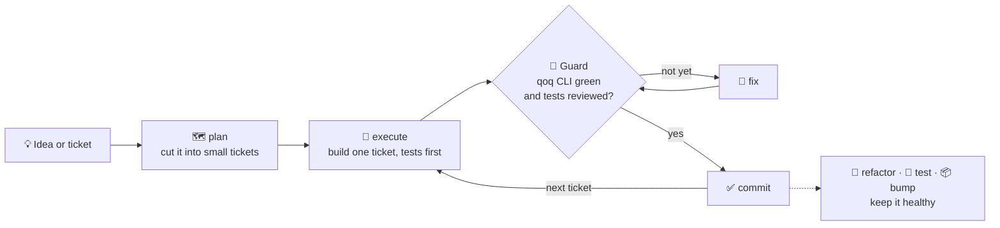

<p align="center">
  
</p>

# Quality over Quantity (QoQ)

**A streamlined suite of tools to format, lint, and analyze any JavaScript/TypeScript project with minimal setup — and a Claude Code skill that turns those checks into a guarded delivery loop.**

🚀 **Why QoQ?**

- 🛠 **Zero-hassle Configuration** – Set up once and focus on coding.
- ⚡ **Optimized Performance** – Run tools efficiently without redundant overhead.
- 🔬 **Precision over Bulk** – Enforce best practices with well-curated presets.

## 📦 What's Included?

QoQ provides essential tooling to ensure code quality across all your projects:

- **ESLint v9** – Enforce best practices with extendable, opinionated presets.
- **Prettier** – Automatically format code for consistency.
- **Knip** – Detect and remove unused code effortlessly.
- **JSCPD** – Identify and eliminate duplicate code.
- **Stylelint** – Lint CSS/SCSS with opinionated presets.
- **Structurelint** – Validate project file/folder structure (via `@ladamczyk/structurelint`).
- **Skillslint** – Lint Claude Code skill documentation (via `@ladamczyk/skillslint`).
- **Dependency checks** – Flag outdated, deprecated and stale dependencies on a configurable cadence.

Most tools are available as an independent package under the `@ladamczyk/qoq-*` namespace, making it easy to integrate and customize. Structurelint and Skillslint are optional integrations backed by separate `@ladamczyk/structurelint` and `@ladamczyk/skillslint` packages.

## 🚀 Getting Started

### 1️⃣ Install QoQ

```sh
npm install @ladamczyk/qoq-cli
```

### 2️⃣ Set Up Configuration

QoQ uses an intuitive **Config Wizard** to guide you through setup. Run:

```sh
npx -y @ladamczyk/qoq-cli --init
```

This will generate a `qoq.config.js` file with all necessary configurations.

### 3️⃣ Run Quality Checks

- `qoq --check` – Runs a full code check, typically used in the CI lint step or pre-push hook.
- `qoq staged` – Checks only staged changes, typically used in the pre-commit hook.
- `qoq --fix` – Fixes issues where possible, typically triggered manually after hooks or a CI failure to quickly correct problems.

`qoq scan [--json] [--output <path>] [--timeout <ms>] [--production] [--silent]` – On-demand vulnerability scan of `package-lock.json`. Not part of the checks above; see [scan docs](./packages/cli/docs/CONFIG.md#scan).

## 🤖 The qoq skill — a guarded delivery loop on top of the CLI

The CLI is a gate. The `qoq` [Claude Code](https://claude.com/claude-code) skill is a small SDLC harness built on that gate: a guarded delivery loop that takes work from requirements to committed code. Every step has to clear the CLI's own verdict, read from its `--json` reports, so nothing lands that the CLI rejects.



- **Plan** – `/qoq plan` breaks a spec, or a Jira, Linear or Trello milestone, into milestones and tickets with contracts and acceptance criteria. `/qoq replan` reshapes the plan when the requirements or the codebase move. `/qoq fullstack-plan` plans one feature across several repos that ship together, such as a UI and its API: one contract, one plan per repo, executed in parallel up to the points where one repo needs another's delivered work.
- **Execute** – `/qoq execute` delivers the plan one ticket at a time under TDD: red, green, tidy. A ticket is committed only after `/qoq fix` passes and an independent reviewer approves its tests.
- **Keep it healthy** – `/qoq fix` loops on CLI findings until they pass. `refactor`, `test`, `bump` and `compress` handle duplication and code smells, missing coverage, dependency upgrades and agent-facing docs.

Agent-written code meets the same standard as code you write by hand. Each run also leaves things the next one builds on: plans, specs and a clean lint baseline.

```text
/plugin marketplace add ladamczyk-it/qoq
/plugin install qoq@qoq-agent-skills
```

In an interactive terminal, the CLI mentions the skill at the end of a run, including `qoq scan`, if it isn't installed yet. When the run found something the skill handles, the hint names the command for it:

- ESLint or Stylelint findings `--fix` can't resolve, or Knip or Structurelint findings → `/qoq fix`
- duplicated code (JSCPD) → `/qoq refactor`
- outdated or deprecated dependencies, or `qoq scan` vulnerabilities → `/qoq bump`

Set `hints: false` in `qoq.config.js` to hide it.

## 🏗 Project Structure

QoQ is designed for flexibility and ease of use. Its core components include:

📂 **Config Wizard** – Guides setup and generates a config file.
📂 **Config Handlers** – Manages default and user-defined settings.
📂 **Executors** – Executes commands efficiently, handling errors and performance optimizations.

For more details, check out our [technical documentation](./packages/cli/README.md).

## 🌍 Contributing

Join us in making QoQ even better! Read our [Contributing Guidelines](https://github.com/ladamczyk-it/qoq/blob/master/.github/CONTRIBUTING.md) before submitting changes.

---

💡 **QoQ: Focus on writing great code, we handle the rest.**

_Feel free to join us, please read [Contributing Guidelines](https://github.com/ladamczyk-it/qoq/blob/master/.github/CONTRIBUTING.md)_

## Last 12 months usage statistics (>=6.0.0)

Regenerated on each release, for daily updated numbers click on chart or visit [https://adamczyk.ovh/docs/qoq/introduction#usage-statistics](https://adamczyk.ovh/docs/qoq/introduction#usage-statistics).

[](https://adamczyk.ovh/img/stats/qoq.png)

[](https://adamczyk.ovh/img/stats/qoq-skill.png)
