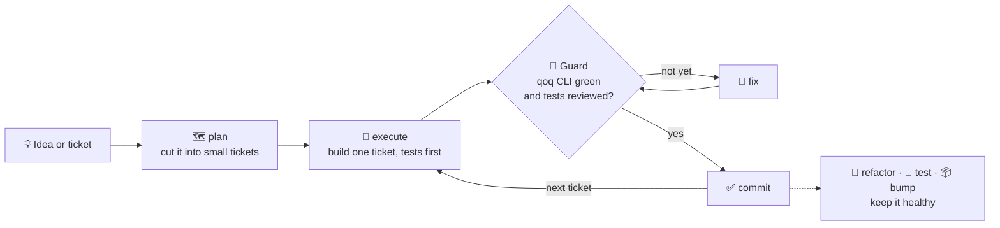

<p align="center">
  
</p>

# Quality over Quantity (QoQ)

**A streamlined suite of tools to format, lint, and analyze any JavaScript/TypeScript project with minimal setup — and a Claude Code skill that turns those checks into a guarded delivery loop.**

🚀 **Why QoQ?**

- 🛠 **Zero-hassle Configuration** – Set up once and focus on coding.
- ⚡ **Optimized Performance** – Run tools efficiently without redundant overhead.
- 🔬 **Precision over Bulk** – Enforce best practices with well-curated presets.

## 📦 What's Included?

QoQ provides essential tooling to ensure code quality across all your projects:

- **ESLint v9** – Enforce best practices with extendable, opinionated presets.
- **Prettier** – Automatically format code for consistency.
- **Knip** – Detect and remove unused code effortlessly.
- **JSCPD** – Identify and eliminate duplicate code.
- **Stylelint** – Lint CSS/SCSS with opinionated presets.
- **Structurelint** – Validate project file/folder structure (via `@ladamczyk/structurelint`).
- **Skillslint** – Lint Claude Code skill documentation (via `@ladamczyk/skillslint`).
- **Justify-disable** – Check that lint-disable comments carry a justification (via `@ladamczyk/justify-disable`).
- **Dependency checks** – Flag outdated, deprecated and stale dependencies on a configurable cadence.

Most tools are available as an independent package under the `@ladamczyk/qoq-*` namespace, making it easy to integrate and customize. Structurelint, Skillslint and Justify-disable are optional integrations backed by separate `@ladamczyk/structurelint`, `@ladamczyk/skillslint` and `@ladamczyk/justify-disable` packages.

## 🚀 Getting Started

### 1️⃣ Install QoQ

```sh
npm install @ladamczyk/qoq-cli
```

### 2️⃣ Set Up Configuration

QoQ uses an intuitive **Config Wizard** to guide you through setup. Run:

```sh
npx -y @ladamczyk/qoq-cli --init
```

This will generate a `qoq.config.js` file with all necessary configurations.

### 3️⃣ Run Quality Checks

- `qoq --check` – Runs a full code check, typically used in the CI lint step or pre-push hook.
- `qoq staged` – Checks only staged changes, typically used in the pre-commit hook.
- `qoq --fix` – Fixes issues where possible, typically triggered manually after hooks or a CI failure to quickly correct problems.

`qoq scan [--json] [--output <path>] [--timeout <ms>] [--production] [--silent]` – On-demand vulnerability scan of `package-lock.json`. Not part of the checks above; see [scan docs](./packages/cli/docs/CONFIG.md#scan).

## 🤖 The qoq skill — a guarded delivery loop on top of the CLI

The CLI is a gate. The `qoq` [Claude Code](https://claude.com/claude-code) skill is a small SDLC harness built on that gate: a guarded delivery loop that takes work from requirements to committed code. Every step has to clear the CLI's own verdict, read from its `--json` reports, so nothing lands that the CLI rejects.



- **Plan** – `/qoq plan` breaks a spec, or a Jira, Linear or Trello milestone, into milestones and tickets with contracts and acceptance criteria. `/qoq replan` reshapes the plan when the requirements or the codebase move.
- **Execute** – `/qoq execute` delivers the plan one ticket at a time test-first, one acceptance criterion at a time, on top of Matt Pocock's [`tdd`](https://github.com/mattpocock/skills) skill. A ticket is committed only after `/qoq fix` passes and an independent reviewer approves its tests.
- **Keep it healthy** – `/qoq fix` loops on CLI findings until they pass. `refactor`, `test`, `bump` and `compress` handle duplication and code smells, missing coverage, dependency upgrades and agent-facing docs.

Agent-written code meets the same standard as code you write by hand. Each run also leaves things the next one builds on: plans, specs and a clean lint baseline.

```text
/plugin marketplace add ladamczyk-it/qoq
/plugin marketplace add DietrichGebert/ponytail
/plugin install qoq@qoq-agent-skills
```

Installing `qoq` also installs the two plugins it depends on: [`mattpocock-skills`](https://github.com/mattpocock/skills) from Claude Code's official marketplace, and [`ponytail`](https://github.com/DietrichGebert/ponytail). See [Built on](#-built-on) for what each one is used for.

### Your `qoq:check` and `qoq:fix` scripts

The skill runs your project's own scripts, never its own copy of the command. It
reads **only** these two names from `package.json`, and it asks to add any that's missing:

```json
{
  "scripts": {
    "qoq:check": "qoq --check --skip-npm",
    "qoq:fix": "qoq --fix"
  }
}
```

- `qoq:check` is the gate. Every `fix` loop runs it as `npm run qoq:check -- --json`, so your `--skip-<tool>` flags hold. The digest's first line quotes the script, so a skipped tool is never mistaken for a passing one.
- `qoq:fix` applies the auto-fixes, run as written.
- Each must be a single `qoq` command. `--json` is appended to the end, so an env prefix (`FOO=1 qoq --check`) or a chain breaks the gate.
- No other script is read. A `lint` or `foo:check` that runs `qoq` isn't the gate. Turning a tool off for good belongs in `qoq.config`.

**Working across several repos?** `qoq-fullstack` is a separate plugin for one feature that spans an API and a UI, or any set of qoq-based repos in one parent folder. `/qoq-fullstack plan` grills the business side only into a Given/When/Then master plan. Each repo then plans and delivers its own share with `qoq`, in its own background session and in parallel with the others. A repo's work is unblocked only by a delivered milestone, and a master milestone only by its integration check. The chief of staff's session shows a feature board above the prompt, with one line per repo saying what it's working on or waiting for. Installing it also installs `qoq`:

```text
/plugin install qoq-fullstack@qoq-agent-skills
```

### 🙏 Built on

The skill builds on other people's skills rather than writing its own copy of them. **Used** means qoq invokes the skill, or preloads it into one of its agents, when a command runs, so you get whatever version you have installed. **Inspired by** means an idea was adopted and written into qoq's own files.

| Skill                                                                                                         | From                                                                  | Used by           | How                                                                                                                                                                                   |
| ------------------------------------------------------------------------------------------------------------- | --------------------------------------------------------------------- | ----------------- | ------------------------------------------------------------------------------------------------------------------------------------------------------------------------------------- |
| [`tdd`](https://github.com/mattpocock/skills/tree/main/skills/engineering/tdd)                                | [mattpocock/skills](https://github.com/mattpocock/skills)             | `execute`, `test` | **Used**: preloaded into `qoq-developer`, `qoq-tester` and `qoq-test-reviewer`. Every spec is written red → green on top of it                                                        |
| [`codebase-design`](https://github.com/mattpocock/skills/tree/main/skills/engineering/codebase-design)        | [mattpocock/skills](https://github.com/mattpocock/skills)             | `plan`, `replan`  | **Used**: preloaded into `qoq-architect` for its contracts vocabulary                                                                                                                 |
| [`grilling`](https://github.com/mattpocock/skills/tree/main/skills/productivity/grilling)                     | [mattpocock/skills](https://github.com/mattpocock/skills)             | `plan`, `replan`  | **Used**: the interview that closes gaps in the requirements                                                                                                                          |
| [`domain-modeling`](https://github.com/mattpocock/skills/tree/main/skills/engineering/domain-modeling)        | [mattpocock/skills](https://github.com/mattpocock/skills)             | `plan`, `replan`  | **Used**: writes `GLOSSARY.md` and `docs/adr/` during the grill                                                                                                                       |
| [`writing-for-agents`](https://github.com/mattpocock/skills/tree/main/skills/productivity/writing-for-agents) | [mattpocock/skills](https://github.com/mattpocock/skills)             | `compress`        | **Used**: the base every cut is judged against                                                                                                                                        |
| [`code-review`](https://github.com/mattpocock/skills/tree/main/skills/engineering/code-review)                | [mattpocock/skills](https://github.com/mattpocock/skills)             | `review`          | **Used**: the Spec/Standards split, and its smell baseline pasted into the Standards axis                                                                                             |
| [`to-tickets`](https://github.com/mattpocock/skills/tree/main/skills/engineering/to-tickets)                  | [mattpocock/skills](https://github.com/mattpocock/skills)             | `plan`, `replan`  | **Inspired by**: how tickets are sliced. Vertical slices, and a prefactor ticket first                                                                                                |
| [`diagnosing-bugs`](https://github.com/mattpocock/skills/tree/main/skills/engineering/diagnosing-bugs)        | [mattpocock/skills](https://github.com/mattpocock/skills)             | `sheriff`         | **Inspired by**: its rule to redact every secret, adopted by `qoq-sheriff`                                                                                                            |
| [`ponytail-review`](https://github.com/DietrichGebert/ponytail)                                               | [DietrichGebert/ponytail](https://github.com/DietrichGebert/ponytail) | `refactor`        | **Used**: assessment 3, what can be deleted                                                                                                                                           |
| [Refactoring, ch. 3](https://martinfowler.com/books/refactoring.html)                                         | Martin Fowler                                                         | `review`          | **Inspired by**: the code smells in `code-review`'s baseline                                                                                                                          |
| [Design patterns](https://refactoring.guru/design-patterns)                                                   | Refactoring.Guru, after the Gang of Four                              | `refactor`        | **Inspired by**: `assets/patterns/` names the GoF catalogue and links there for more reading. Its text is written from scratch, because the Refactoring.Guru examples are CC BY-NC-ND |
| [`skill-creator`](https://github.com/anthropics/skills/tree/main/skills/skill-creator)                        | [anthropics/skills](https://github.com/anthropics/skills)             | `evals/`          | **Inspired by**: the eval set uses its `evals.json` format                                                                                                                            |

A skill marked **Used** that isn't installed is handled by each command: it either stops with the install command or asks whether to go on without it.

In an interactive terminal, the CLI mentions the skill at the end of a run, including `qoq scan`, if it isn't installed yet. When the run found something the skill handles, the hint names the command for it:

- ESLint or Stylelint findings `--fix` can't resolve, or Knip, Structurelint or Justify-disable findings → `/qoq fix`
- duplicated code (JSCPD) → `/qoq refactor`
- outdated or deprecated dependencies, or `qoq scan` vulnerabilities → `/qoq bump`

Set `hints: false` in `qoq.config.js` to hide it.

## 🏗 Project Structure

QoQ is designed for flexibility and ease of use. Its core components include:

📂 **Config Wizard** – Guides setup and generates a config file.
📂 **Config Handlers** – Manages default and user-defined settings.
📂 **Executors** – Executes commands efficiently, handling errors and performance optimizations.

For more details, check out our [technical documentation](./packages/cli/README.md).

## 🌍 Contributing

Join us in making QoQ even better! Read our [Contributing Guidelines](https://github.com/ladamczyk-it/qoq/blob/master/.github/CONTRIBUTING.md) before submitting changes.

---

💡 **QoQ: Focus on writing great code, we handle the rest.**

_Feel free to join us, please read [Contributing Guidelines](https://github.com/ladamczyk-it/qoq/blob/master/.github/CONTRIBUTING.md)_

## Last 12 months usage statistics (>=6.0.0)

Regenerated on each release, for daily updated numbers click on chart or visit [https://adamczyk.ovh/docs/qoq/introduction#usage-statistics](https://adamczyk.ovh/docs/qoq/introduction#usage-statistics).

[](https://adamczyk.ovh/img/stats/qoq.png)

[](https://adamczyk.ovh/img/stats/qoq-skill.png)
