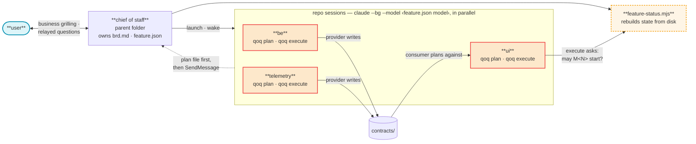
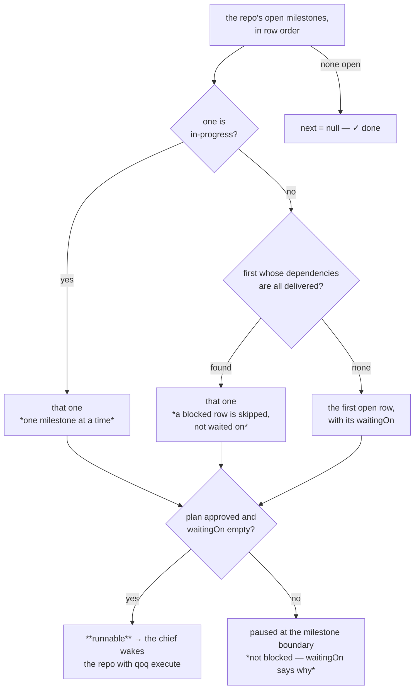
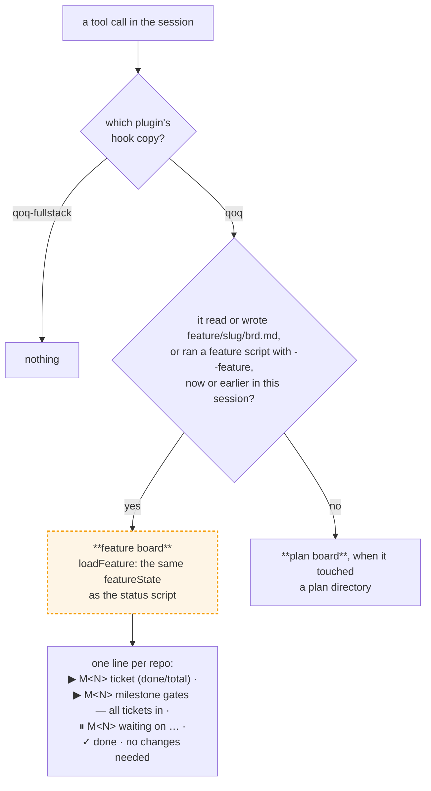

# QoQ fullstack workflows — diagrams

Diagrams for [`skills/qoq-fullstack`](../skills/qoq-fullstack/SKILL.md). The prose
wins on a disagreement, and the chart and the prose change in the same commit.
The protocol a repo's own `qoq plan` and `qoq execute` follow is in
[qoq-workflows.md](qoq-workflows.md#a-plan-under-a-feature).

| Diagram                           | Prose it reflects                                                                                                                                                                                                                                                                                          |
| --------------------------------- | ---------------------------------------------------------------------------------------------------------------------------------------------------------------------------------------------------------------------------------------------------------------------------------------------------------- |
| [Overview](#overview)             | [SKILL.md](../skills/qoq-fullstack/SKILL.md)                                                                                                                                                                                                                                                               |
| [Sub-commands](#sub-commands)     | [plan.md](../skills/qoq-fullstack/references/plan.md), [execute.md](../skills/qoq-fullstack/references/execute.md), [feature-status.mjs](../skills/qoq/scripts/feature-status.mjs), [status.mjs](../skills/qoq-fullstack/scripts/status.mjs), [schedule.mjs](../skills/qoq-fullstack/scripts/schedule.mjs) |
| [Next milestone](#next-milestone) | [feature-state.mjs](../skills/qoq/scripts/feature-state.mjs), [execute.md](../skills/qoq-fullstack/references/execute.md)                                                                                                                                                                                  |
| [Feature board](#feature-board)   | [register.tsx](../hooks/register.tsx), [feature.ts](../hooks/feature.ts)                                                                                                                                                                                                                                   |

**Legend.** Amber dashed = a script run directly. Cyan = the user. Red = a `qoq` command run inside a repo session.

## Overview

One chief of staff in the parent folder, one background session per repo. The
files on disk are the state, and messages only wake the chief of staff up.

## Sub-commands

```mermaid
flowchart TD
    PSUB{"sub-command?"}
    PSUB -->|status| PSTAT["**status.mjs**<br/>print its tables — read-only"]
    PSUB -->|plan| PJSON{"feature.json<br/>in the parent folder?"}
    PJSON -->|no| PJASK(["**ASK THE USER**<br/>repos · after (dependency order) ·<br/>integration checks · permissionMode · model<br/>— never guessed"])
    PJASK --> PGRILL
    PJSON -->|yes| PGRILL["**grilling — business only**<br/>actors · Given/When/Then ·<br/>milestone edges. *no repo is named:<br/>a technology question is parked<br/>for the repos, never asked here*"]
    PGRILL --> PBRD(["**ASK THE USER**<br/>approve brd.md"])
    PBRD --> PREPO["**every** repo, in **after** order:<br/>claude --bg --model ‹model› --name project-repo<br/>→ **qoq plan** on the whole BRD →<br/>a plan, or **no changes needed**"]
    PREPO --> PRELAY(["**relay** each repo's grilling<br/>and approval to the user,<br/>verbatim, prefixed by repo"])
    PRELAY --> PCON["approved: Repo plans row = plan dir or none ·<br/>provider writes contracts/name.md →<br/>start repos whose after is settled"]
    PCON --> PSCHED["**schedule.mjs** — automatic, no questions:<br/>simulate the parallel run, reorder rows<br/>so the piece another repo needs goes first.<br/>*hard dependencies never move*"]
    PSCHED --> PCOV{"every master milestone<br/>served by a repo milestone?"}
    PCOV -->|gap| PREPLAN["that repo: **qoq replan**"]
    PREPLAN -.-> PCOV
    PCOV -->|yes| PEXEC
    PSUB -->|execute| PSETUP
    PEXEC["offer **execute**"] --> PSETUP
    PSETUP(["**setup, once per repo**<br/>crossSessionInbound accept +<br/>bgIsolation none? ·<br/>claude --version · feature/slug branch"])
    PSETUP --> PLOOP["**feature-status.mjs**<br/>*the files are the state*"]
    PLOOP --> PWAKE["each repo with **next.runnable**,<br/>idle or gone → **qoq execute** in it.<br/>*repos in parallel; one ticket<br/>at a time inside each*"]
    PWAKE --> PDUE{"a master milestone<br/>integrationDue?"}
    PDUE -->|yes| PINT["run its checks —<br/>npm run script in that repo"]
    PINT -->|pass| PDEL["master row → **delivered**<br/>*the only write that<br/>unblocks the next master*"]
    PINT -->|fail| PFAIL(["**ASK THE USER**<br/>which repo takes the fix →<br/>its qoq replan"])
    PDUE -->|no| PWAIT
    PDEL --> PWAIT
    PFAIL -.-> PWAIT
    PWAIT["wait: a message or an idle notice<br/>*a repo writes its plan file first,<br/>then messages*"] --> PLOOP
    PWAIT -->|"escalation relayed"| PESC(["**ASK THE USER**<br/>only repos waiting on it stop"])
    PESC -.-> PLOOP

    classDef command fill:#f59e0b1a,stroke:#f59e0b,stroke-width:2px,stroke-dasharray:4 3
    classDef user fill:#06b6d422,stroke:#0891b2,stroke-width:2px
    classDef skill fill:#ef44441f,stroke:#ef4444,stroke-width:2px
    class PSTAT,PLOOP,PSCHED command
    class PJASK,PBRD,PRELAY,PSETUP,PFAIL,PESC user
    class PREPO,PWAKE,PREPLAN,PEXEC skill
```

## Next milestone

What `feature-status.mjs` reports as a repo's `next`, and so what the chief of
staff wakes it for. The band reads the same function.

A dependency counts as delivered when its milestone row says so. For
`<repo>:M<N>` that's the other repo's row, and an unknown name never counts.
A milestone that serves master M&lt;k&gt; also waits for every master milestone
M&lt;k&gt; depends on to pass its integration check.

## Feature board

The band above the prompt. Only the `qoq` copy of `hooks/` draws it. The
`qoq-fullstack` copy draws nothing, so installing both never stacks two bands.

