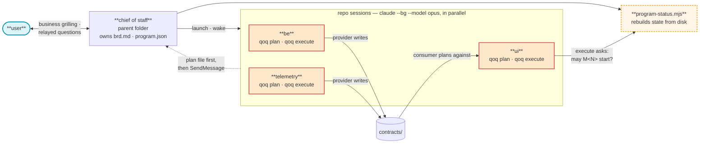

# QoQ fullstack workflows — diagrams

Diagrams for [`skills/qoq-fullstack`](../skills/qoq-fullstack/SKILL.md). The prose
wins on a disagreement, and the chart and the prose change in the same commit.
The protocol a repo's own `qoq plan` and `qoq execute` follow is in
[qoq-workflows.md](qoq-workflows.md#a-plan-under-a-program).

| Diagram                       | Prose it reflects                                                                                                                                                                  |
| ----------------------------- | ---------------------------------------------------------------------------------------------------------------------------------------------------------------------------------- |
| [Overview](#overview)         | [SKILL.md](../skills/qoq-fullstack/SKILL.md)                                                                                                                                       |
| [Sub-commands](#sub-commands) | [plan.md](../skills/qoq-fullstack/references/plan.md), [execute.md](../skills/qoq-fullstack/references/execute.md), [program-status.mjs](../skills/qoq/scripts/program-status.mjs) |

**Legend.** Amber dashed = a script run directly. Cyan = the user. Red = a `qoq` command run inside a repo session.

## Overview

One chief of staff in the parent folder, one background session per repo. The
files on disk are the state, and messages only wake the chief of staff up.

## Sub-commands

