# `bump` — analyse, choose, then produce patches

Update npm dependencies without losing the ability to say **which one** broke something. Everything here follows from that: one patch at a time, full validation after each, and a split ladder instead of an abandoned group.

**A clean tree is a precondition, not a preference.** A dirty tree makes git unable to tell a bump's damage from your own uncommitted work, so the command stops and says so rather than warning and proceeding.

```mermaid
flowchart TD
    CLEAN{"worktree<br/>clean?"}
    CLEAN -->|no| BSTOP(["<b>stop</b> — commit or<br/>stash first"])
    CLEAN -->|yes| PLAN["<b>impact analysis</b> — what's outdated,<br/>minor/patch grouped,<br/><b>one major step per package</b><br/><i>(nothing written, no patches yet)</i>"]
    PLAN --> MAJ{"majors, or queued<br/>failures, among them?"}
    MAJ -->|yes| BUMPER["dispatch <b>qoq-bumper</b><br/>(Sonnet, one per package,<br/><b>all in one message</b>;<br/>a failed one → <i>analysis failed</i>)<br/><i>(name, current version)</i>"]
    MAJ -->|no| BAPPR

    subgraph BUMPFLOW["qoq-bumper flow <i>(everything the agent does)</i>"]
        direction TB
        MB0{"a newer major<br/>than current?"}
        MB0 -->|yes| MB1
        MB0 -->|"no — already on the<br/>latest major line"| MBL["target = <b>latest stable</b><br/>within it"]
        MBL --> MB1
        MB1["read the changelog / release notes /<br/>migration docs for <b>current → target</b>"]
        MB1 --> MB2["grep <b>this codebase</b> for the<br/>APIs that actually changed"]
        MB2 --> MB3["return: breaking changes that<br/>land here, migration steps, risk<br/>— <i>no edits</i>"]
    end

    BUMPER --> MB0
    MB3 --> BAPPR(["<b>ASK THE USER</b><br/>here's the impact —<br/><b>pick / exclude</b>, then approve"])

    BAPPR -.->|"nothing picked"| BSTOP
    BAPPR -.->|"the chosen set"| MAKE["<b>now</b> write the git patches —<br/>one per bump, selected only<br/><i>package.json only — never the lockfile</i>"]
    MAKE --> BAPPLY

    BAPPLY["apply next patch<br/>+ reinstall<br/><i>the install alone regenerates the lockfile;<br/>a failed install is a failed patch</i>"]
    BAPPLY --> BVAL["<b>validate</b> — all three, in order<br/>`qoq fix` · `test` full suite · `build`<br/><i>(commands from the record)</i>"]
    BVAL -->|passes| PREF["<b>qoq refactor --decisions auto</b><br/>scope = this patch's files —<br/><i>applies the safe tier,<br/>advises the rest</i>"]
    PREF -->|"changed nothing"| BMORE{"patches left?"}
    PREF -->|"changed something"| BREVAL["<b>re-validate</b> — test + build<br/><i>(the refactor's own fix already ran)</i>"]
    BREVAL -->|passes| BMORE
    BREVAL -->|fails| BSPLIT
    BVAL -->|fails| BSPLIT{"can this patch<br/>split further?"}
    BSPLIT -->|"yes — grouped → <b>minor</b> / <b>patch</b>,<br/>then → <b>one per package</b>"| BRECUT["revert it <i>(git restore package.json<br/>+ lockfile, reinstall)</i>,<br/>re-cut at the next level down"]
    BRECUT --> BAPPLY
    BSPLIT -->|"no — one package left"| BSEEN{"already been through<br/><b>qoq-bumper</b>?"}
    BSEEN -->|no| BQ["revert it, <b>queue the package<br/>for qoq-bumper</b><br/><i>(next round)</i>"]
    BSEEN -->|yes| BREV["revert it, carry the package<br/>as unbumpable + why"]
    BQ --> BMORE
    BREV --> BMORE
    BMORE -->|yes| BAPPLY
    BMORE -->|no| BEHIND{"a major still behind,<br/>or a queued failure?"}
    BEHIND -->|"yes — re-plan,<br/>re-approve"| PLAN
    BEHIND -->|no| BDONE(["<b>done</b> — applied,<br/>reverted, skipped"])

    classDef agent fill:#8b5cf61f,stroke:#8b5cf6,stroke-width:2px
    classDef user fill:#06b6d422,stroke:#0891b2,stroke-width:2px
    classDef skill fill:#ef44441f,stroke:#ef4444,stroke-width:2px

    class BUMPFLOW agent
    class BAPPR user
    class PREF,BVAL skill
```



## The plan is an impact analysis, not a patch set

The planning phase **writes nothing** — not the tree, not a patch file. It works out what's outdated, groups minor and patch bumps, and plans **at most one major step per package**. Majors (and any package queued from a previous round's failure) get a `qoq-bumper` dispatch, which is the analysis itself. A round's bumpers all go out at once and the plan waits for every one; a bumper that fails is reported as _analysis failed_, never retried on a dearer model:

> `qoq-bumper` reads the changelog, release notes and migration guide for _current → target_, then greps **this codebase** for the APIs that actually changed. It returns the breaking changes that land here, the migration steps, and a risk read — and edits nothing.

It reads the [report](https://outdated.adamczyk.ovh/docs/json-output) from [Outdated](https://outdated.adamczyk.ovh/docs/qoq), not just the version gap. `majorBump` separates the majors. `latestInMajor` is the minor/patch target: above `current` it's a bump even when an exact pin leaves `wanted` equal to `current`, and it joins the minor/patch group even when the package also has a major pending, which is planned separately. `deprecated` and `stale` packages are worth raising even with no bump pending, and `blocked` means the newest release needs a newer Node than this one — not a bump to attempt.

Then, per package: current → target, minor/patch or major, and for majors what the agent found. With the scan on, vulnerabilities go first, each with the finding that put it there. That's the material for a decision. **You pick and exclude**, and only then are patches written for the chosen set — writing every patch up front materialises diffs for bumps that are about to be rejected, and frames the question as yes/no on a finished artifact when the real question is _which of these_. An empty selection is a valid answer and ends the run.

## Vulnerabilities — experimental, `--scan`

The vulnerability scan is **off by default**. It's on only with `--scan`, or when `qoq.config.*` sets `future: { unstable_skill_bump_with_scan: true }`. Off, the plan comes from the outdated report alone and says so in one line — `vulnerability scan off` — so it's never read as clean.

On, [`qoq scan --json`](../../configuration.md#scan) writes `scan-report.json` next to the outdated report, and a vulnerable package joins the plan even when the outdated report flags it `ok`. Every finding is listed, highest severity first, whatever `failOn` says. A finding's `fixVersion` is the floor for that package's target; with none published it's listed as `no fix published` and nothing is planned for it. A scan that was `skipped` or `inconclusive` — offline, a timeout, no `package-lock.json` — is one plan line saying it didn't run, never presented as clean.

**A transitive vulnerability is fixed through its parent first, an override last.** The finding's `via` names each way the package is installed. In order:

1. **Bump `via.direct`**, in the manifest that declares it. When `direct` is the parent, one `npm view <direct>@<latestInMajor> dependencies.<package>` checks whether that release admits a fixed copy; if not, `latest` is tried. When they differ, nothing on disk proves the bump fixes it, so it's planned as unproven, and a finding still there at the final re-scan moves to step 2 next round.
2. **Otherwise suggest an override** at `fixVersion`, scoped to the parent — `"overrides": { "<parent>": { "<package>": "<fixVersion>" } }` — in the root `package.json`, since npm ignores a workspace's. One that falls outside the range the parent declares is offered as a separate choice that says so.
3. **Otherwise** it's `no fix available`, with the reason.

The vulnerable package is never added to `package.json` as a direct dependency. An override is pinned without the parent's author ever testing it, which is why it's last and always your pick, never implied by picking the package.

**Existing overrides are tested for removal after the bumps, one at a time** — only those whose target or parent is in the subtree of the packages you picked. Each is removed, reinstalled, validated and re-scanned, and dropped only when both are clean; otherwise it's restored exactly as it was and reported as kept, with the reason. Overrides aren't all security — a compatibility pin shows up as red validation, not a scan finding — which is why both have to pass.

**One re-scan closes the run**, reporting every planned-for finding that's still there. A suggested override whose own version turns out to have an advisory comes back to you, never stepped up unasked.

## A patch is `package.json`; the lockfile comes only from a reinstall

A patch changes version ranges in `package.json` and nothing else. The lockfile is **never** written by hand — not in the patch, not to fix up a version, a `resolved` URL or an `integrity` hash, not to clear a conflict. Applying a patch means `package.json`, then the project's own install (`npm install`, or the matching `pnpm`/`yarn` command), which regenerates it. A hand-edited lockfile describes a tree the package manager never resolved, so validation would pass against `node_modules` a fresh `npm ci` won't reproduce.

An install that fails, or warns about an unresolvable peer, is a **failed patch** and goes down the split ladder like a failing test. Reverting restores `package.json` and the lockfile from git — the last-green state — then reinstalls. Deleting the lockfile to regenerate it from scratch re-resolves every transitive dependency at once, which is a change you never approved, so the command stops and asks instead.

## Validation is all three, after every patch

```text
qoq fix           →  green
test (full suite) →  green
build             →  green
```

Cheapest signal first, so a formatting-level break doesn't cost a full suite run.

**Green means no worse than the baseline.** Before the first patch the check runs once, nothing fixed, and its findings become the baseline. After each patch, `fix`'s loop acts only on findings the baseline doesn't have — a pre-existing finding isn't the patch's, and fixing it would mix unrelated edits into the patch. The baseline is listed once, in the final report. `test` and `build` get no baseline: either one red before the first patch stops the run, the same as a dirty tree.

There's no per-patch reasoning about which checks are safe to skip: a dependency bump can break anything — the command exists because you can't predict what — and a narrowed check that passes just surfaces the breakage three patches later, against a tree where four things changed.

## Then `refactor`, after the patch lands

Validation says a patch didn't break anything. It doesn't say the migration code is any good — and migration code is exactly where the rushed adapter and the copy-pasted shim show up. So each patch that validates green gets one [`refactor --decisions auto`](./refactor.md#--decisions-auto) over **that patch's changed files**, after apply-and-validate rather than before: the assessments then read real files in a real tree, against the version actually installed.

The cost is a second validation pass — test and build only, since the refactor's own re-green already ran `fix` — on any patch the refactor actually touched. Patches it leaves alone, which is most version-string bumps, skip it entirely.

## A failing patch splits before it's abandoned

The grouped minor/patch patch is where attribution goes soft: fifteen packages in one diff, one breaks the suite, and reverting throws away the fourteen that were fine. A failure is the signal to cut finer and try again.

| Level | The patch                         | On failure                                             |
| ----- | --------------------------------- | ------------------------------------------------------ |
| 1     | everything minor + patch, grouped | split into **minor** and **patch**                     |
| 2     | one patch per bump kind           | split into **one patch per package**                   |
| 3     | a single package                  | revert, hand to `qoq-bumper`, queue for the next round |

Each level reverts, re-cuts and re-applies from the last-green tree, so no level inherits the previous one's damage. **Splitting minor before patch, rather than bisecting**, is deliberate — it's the axis that correlates with breakage. **Level 3 is where the ladder stops**: a package that has already been through `qoq-bumper` and still fails is carried as unbumpable with the failure named, because re-reading the same changelog to get the same answer is a loop, not a retry.

Re-cutting never needs re-approval: it changes how the approved bumps are sliced, not which ones were approved. An override the plan suggested is one change, so it can't split: a failure reverts it and reports it.

## One major step per package, per round

A round moves each package **at most one major**. A package two majors behind gets planned to the next one only; when that lands green the whole thing loops — re-plan, re-dispatch `qoq-bumper` against the _new_ current version, and **ask for approval again**.

Analysing v3 → v5 in one go asks the agent to reason about a migration from a starting point that doesn't exist yet, and asks you to choose on evidence that doesn't apply. Two majors is two decisions, and approval is never inherited from the previous round.
