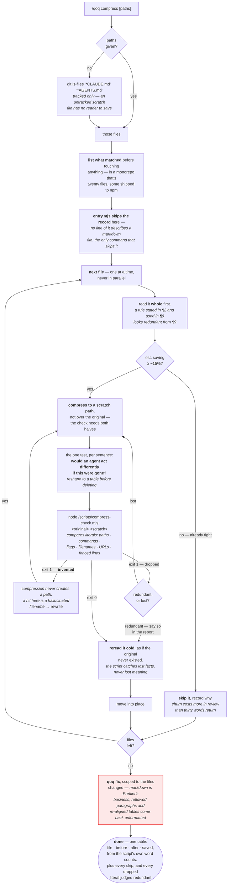

# `compress` — strip agent docs to what an agent acts on

Markdown written for agents gets read on every single run, forever. A paragraph of rationale that a human reads once is a paragraph the model pays for a thousand times. This command deletes the part nobody acts on and keeps the part somebody does.

```text
/qoq compress                              # every CLAUDE.md and AGENTS.md git tracks
/qoq compress docs/qoq-workflows.md        # those files only
/qoq compress skills/qoq/references        # every .md underneath
```

The default is what agents load without being asked for it — `git ls-files '*CLAUDE.md' '*AGENTS.md'`, tracked files only, because an untracked scratch file has no reader to save and `node_modules` is full of other people's docs. What matched is **listed before anything is touched**: in a monorepo that default can be twenty files, and some of them ship to npm.

**It's the one command that skips discovery**, and `entry.mjs` knows it by name. Every line of the record answers "how is this project built, tested, checked", and none of that bears on editing prose — reading a manifest to learn the test command before deleting an adjective would be this command failing at its own premise. Discovery is deferred, not skipped: the closing `fix` call does its own.



## The base — `writing-for-agents`

`compress` is built on `writing-for-agents`, resolved from the available-skills list (a bare name and a `mattpocock-skills:` one don't resolve interchangeably) **after the files are listed and before the first one is read**, and invoked once for the run. Its vocabulary — single source of truth, environment as a cache, sediment, context pointers, leading words, positive phrasing — is what every cut below is judged in. The rules here add what's specific to `compress` (the one test, the literal check, headings as an API) and **win where the two conflict**: a hard guardrail keeps its ban, with the positive target beside it.

Missing → it asks once: install and re-run (recommended; it normally arrives with qoq as a plugin dependency, `/plugin install mattpocock-skills`) or proceed without it, on the one test and the literal check alone. Proceeding is a real option, and the final table's caption names the skipped base.

## What compression is

One test, applied sentence by sentence: **would an agent do anything differently if this were gone?** No → cut it. That's the whole judgement, and it's sharper than a word budget because it survives contact with a doc that's already tight.

The other half of the win isn't deletion at all — it's shape. A paragraph of six parallel facts costs twice what the table of six rows costs, and the table is easier to act on. Reach for the reshape before the delete.

| Cut                                                   | Keep                                                      |
| ----------------------------------------------------- | --------------------------------------------------------- |
| rationale that only restates the rule                 | every path, command, flag, filename, version, URL         |
| hedging and throat-clearing — "it's worth noting"     | every rule, constraint, prohibition, ordering requirement |
| the second and third example of an already-clear rule | conditionals — "if X then Y", and both branches           |
| prose that recreates the table next to it             | anything named as a trap, gotcha, or common mistake       |
| history — "we used to do X" — with nothing at stake   | history that exists to stop someone reverting to X        |
| structure a `ls` or a `package.json` already answers  | facts the repo does **not** state anywhere else           |
| motivational framing, apologies, meta-commentary      | headings other files link to                              |

**The "why" is not automatically prose.** Keep a why when it stops a wrong action — the clause explaining why the rule isn't the obvious thing is what stops the next agent from cheerfully re-deriving the obvious thing and undoing it. Cut a why when it only justifies a right action nobody was going to argue with.

> `--json` is what writes the reports at all — without it there's nothing to summarize.

Load-bearing: an agent that reads `--json` as an output-format preference drops it. Twelve words that prevent a silent failure.

> This is important for maintainability and long-term code health.

Nothing acts on it. Gone.

**Headings are an API.** Other files route by heading name and link to their anchors, so rewording one to save four words breaks a link silently — and a broken route costs far more than the words saved.

## Per file, one at a time

Nothing runs in parallel here either: compression is judgement about meaning, and two agents rewriting sibling docs are how the same fact ends up disagreeing with itself in two places.

1. **Read the whole file** before cutting a line of it. A rule stated in paragraph two and relied on in paragraph nine looks redundant from paragraph nine — that's how a lone statement of a constraint gets deleted as a repeat.
2. **Estimate first.** Under ~15% and the file is already tight: skip it, say so, move on. A diff that churns a doc to save thirty words costs more in review than it ever returns.
3. **Write the compressed version to a scratch path**, not over the original — the check needs both halves.
4. **Check it** with `compress-check.mjs <original> <scratch>`, which compares the _literals_ — paths, commands, flags, filenames, URLs, fenced lines — and prints a word delta. Exit 1 means something was `dropped` or `invented`: a list to read, not an automatic revert. Restore each dropped literal or be able to say why it was redundant, and treat `invented` as serious — compression has no business creating a path that wasn't there, so a hit points at a hallucinated filename.
5. **Reread it cold**, as if the original never existed. The script catches lost facts; it can't tell you the sentence you cut was the only thing explaining when a rule applies.
6. **Move it into place** and go to the next file.

## Ending

[`fix`](./fix.md) runs over exactly the files changed — markdown is Prettier's business, and reflowed paragraphs and re-aligned tables come back unformatted otherwise. Then one table, and nothing else:

| File                     | Before | After | Saved                   |
| ------------------------ | ------ | ----- | ----------------------- |
| `CLAUDE.md`              | 364    | 180   | -51%                    |
| `packages/cli/AGENTS.md` | 1204   | 1190  | skipped — already tight |

Word counts come from the script's own output, so the number is measured rather than claimed — plus which files were skipped and why, and any dropped literal judged redundant. That last one is the single judgement call in the run a reader can't recover from the diff.

**It never edits code, config, or tests.** A `.md` file is the whole surface, and no other command calls it: `compress` changes what future runs read, never what this one does. A comment in a source file isn't prose to compress either — it may be the only record of a decision, and it goes only under [`refactor`](./refactor.md), for a reason the skill's code conventions accept.
