# `execute` — an approved plan in, delivered milestones out

Run a plan to completion by dispatching every ticket to a `qoq-developer` at the tier the plan already assigned. This command **never implements anything itself** — its whole job is dispatch, gates, status, and recording delivery.

```mermaid
flowchart TD
    EARG["plan directory — ./plans/[plan]/<br/><i>omitted → asks, unless exactly<br/>one plan is approved</i>"]
    EARG --> ESRC{"--source"}
    ESRC -->|"jira / linear / trello"| EIMP["<b>import</b> — ask which epic/milestone/list,<br/>read it and its tickets into a plan directory,<br/>then continue as if it had always existed"]
    EIMP --> ELOAD
    ESRC -->|"local (default)"| ELOAD["<b>load the plan, fresh from disk</b><br/>index.md, then the next<br/>milestone's file only"]
    ELOAD --> EDRAFT{"Plan status<br/>approved?"}
    EDRAFT -->|draft| EBACK["back to <b>qoq plan</b> —<br/>it was never signed off"]
    EDRAFT -->|approved| EPROG{"any ticket<br/>in-progress?"}
    EPROG -->|"yes — a dead run"| ERECON["reconcile against git log:<br/>committed → done,<br/>otherwise re-dispatch"]
    EPROG -->|no| EBRANCH
    ERECON --> EBRANCH{"on the default<br/>branch?"}
    EBRANCH -->|yes| EASK(["<b>ASK THE USER</b><br/>branch first? plan/[name]"])
    EASK -.-> EWAVE
    EBRANCH -->|no| EWAVE

    EWAVE["<b>next ticket</b> — the first whose<br/>deps are all done, in plan order"]
    EWAVE --> ELIM{"--session-limit or<br/>--weekly-limit given?"}
    ELIM -->|"neither — no gate at all"| EDISP
    ELIM -->|yes| EUSAGE["<b>usage-check.mjs</b>, before <i>each</i> dispatch<br/><i>show its headroom line verbatim</i>"]
    EUSAGE -->|"exit 1 — limit reached"| EUASK(["<b>ASK THE USER</b> — carry on anyway?<br/><i>a yes disarms the gate for this run;<br/>a no leaves the ticket resumable,<br/>not blocked, and files no outcome</i>"])
    EUASK -.-> EDISP
    EUSAGE -->|"exit 0"| EDISP

    EDISP["dispatch <b>one qoq-developer</b> —<br/>model = the ticket's tier · Context · Files ·<br/>criteria · the milestone's <b>Contracts</b><br/><i>never the Scenarios — journey-level</i>"]

    subgraph EDEV["qoq-developer flow — tdd: red → green"]
        direction TB
        T1["<b>red</b> — one criterion at a time:<br/>a failing assertion, proved red"]
        T1 --> T2["<b>green</b> — the minimum that<br/>turns it green, then the next"]
        T2 --> T4["<b>prove it</b> — the project's own `test:one`<br/>+ `build`, then <b>npx qoq staged --skip-knip</b><br/>over the files it touched"]
        T4 -->|"red"| T5{"3 attempts<br/>spent?"}
        T5 -->|no| T2
        T5 -->|"yes"| THAND(["<b>handoff report</b> —<br/>never narrow the ticket,<br/>never weaken the gate"])
        T4 -->|"green"| TRET["hand back: <b>every file changed</b>"]
    end

    EDISP --> T1
    TRET --> EGATE["<b>Gate 1 — qoq fix --skip-knip</b>, scoped to<br/>the files it returned<br/><i>first, because it rewrites formatting</i>"]
    EGATE -->|FAIL| T5
    EGATE -->|PASS| EREV["<b>Gate 2 — qoq-test-reviewer</b> (Sonnet, read-only)<br/>do the specs actually test the criteria?<br/><i>a cold reader — this thread is holding<br/>the developer's own report</i>"]
    EREV -->|"REJECTED — passed back verbatim"| T5
    EREV -->|APPROVED| TCOM["commit exactly this ticket's files,<br/><b>--no-verify</b> — the gates just ran<br/>+ tick each criterion with the<br/><b>assertion the gate mapped to it</b>"]
    TCOM --> EDONE["<b>Status: done</b> + commit hash"]
    THAND --> EESC{"a tier<br/>above?"}
    EESC -->|"yes — fresh dispatch with<br/>the report pasted in"| EDISP
    EESC -->|"no — top rung already"| EBLOCK(["<b>Status: blocked</b> — bring the<br/>user the report: bad ticket,<br/>or session model too small"])
    EDONE --> EREC["<b>estimate.mjs --record</b> —<br/>outcome · attempts · attribution"]
    EBLOCK --> EREC
    EREC --> EMORE{"tickets left in<br/>the milestone?"}
    EMORE -->|yes| EWAVE
    EMORE -->|no| EMGATE["<b>milestone gate</b><br/>qoq refactor --decisions auto over every<br/>file the milestone's tickets touched<br/><i>(its green base is a full qoq fix — Knip on)</i>,<br/>then the <b>full</b> suite + build"]
    EMGATE -->|red| ENEW["write the failure up as a new<br/>ticket — sized, rated, dispatched"]
    ENEW --> EWAVE
    EMGATE -->|green| EDOCS["<b>document</b> — only with docs on<br/>qoq-scribe in plan mode, then a<br/>docs(m&lt;N&gt;) commit<br/><i>never stops the run</i>"]
    EDOCS --> EARCH["<b>deliver</b> — Outcome block on the<br/>milestone file, index row delivered,<br/>later Context updated,<br/><b>gate evidence, not 'green'</b>"]
    EARCH --> EMS{"milestones<br/>left?"}
    EMS -->|yes| EWAVE
    EMS -->|no| EFIN(["<b>done</b> — plan delivered"])

    classDef agent fill:#8b5cf61f,stroke:#8b5cf6,stroke-width:2px
    classDef user fill:#06b6d422,stroke:#0891b2,stroke-width:2px
    classDef skill fill:#ef44441f,stroke:#ef4444,stroke-width:2px

    class EDEV,EREV agent
    class EASK,EUASK user
    class EBACK,EMGATE,EGATE skill
```



## Where the plan comes from — `--source`

`--source local` is the default and needs nothing: a plan directory (`plans/<plan>/`, or its `index.md`), or the single approved plan under `./plans/` when the argument is omitted.

**A plan is a directory.** A bare `plans/<name>.md` is the single-file layout from before v7.0.0, and nothing here reads it: the run says so in one line, names the file, and stops. It isn't converted — a delivered one is history as it stands, and a live one is re-planned with [`plan`](./plan.md).

`--source jira|linear|trello` is **experimental**, on the same per-project switch as [`plan --tool`](./plan.md#--tool--where-the-tickets-end-up): `future.unstable_skill_plan_<tool>: true` in `qoq.config`. It's checked first; with the switch off the run stops in one line naming it, before anything is asked or read from the tracker. With it on, it asks which milestone to run, reads it and its tickets into a plan directory, and then continues **as if it had always existed**. Nothing after the import knows or cares where the tickets came from, which is the whole point of importing rather than executing against a tracker — [`plan --tool`](./plan.md#--tool--where-the-tickets-end-up) is the same road in the other direction, and the plan directory is the source of truth in both.

One thing from the import reaches into the loop: on an imported plan, a ticket arriving at `done` or `blocked` also writes its status label and commit back to the tracker. That is the only write, and it's a **label**, never a workflow column.

## Loading and resuming

Installed as the Claude Code plugin, qoq also shows the run's progress in a band above the prompt: once the session reads or edits an approved or in-progress plan under `plans/`, the band rereads it after every tool call — tickets done and a percentage, or one column per milestone in the details view. The skill knows nothing of it.

**Load the plan fresh from disk every time**, resume or not: the files are the state, and an in-memory copy from earlier in the session goes stale the moment a ticket writes its commit hash back.

- `index.md` is read first: its header and its **Milestones** table, which says which milestone is next — the first row neither `delivered` nor `withdrawn` whose **Depends on** rows are all `delivered`. Then **that milestone's file and nothing else of the plan**: a delivered milestone's file is history, and a later one's tickets aren't this run's business until their turn. What an earlier milestone established reaches them through their own **Context**, written at delivery. The one exception is the end-of-plan pass, which reads every milestone's **Outcome** block.

- **A plan with a `Feature` header line** is one repo's share of a [cross-repo feature](./plan.md#a-repos-share-of-a-feature). The cross-repo answer comes from `qoq`'s `scripts/feature-status.mjs`, and its `next` entry for this repo is the next milestone. A `<repo>:M<N>` dependency, or a master milestone that hasn't passed integration yet, counts like any other dependency that isn't delivered. When `next.runnable` is false the run stops at that milestone boundary and reports what `waitingOn` lists — a normal pause, not a blocked ticket. Every question the run would ask you goes to the chief of staff named in the launch prompt, with `SendMessage`, after the plan file is written.
- A ticket sitting at `in-progress` means a previous run died mid-flight. It's reconciled against `git log` — files committed → mark it `done`, otherwise re-dispatch — rather than asking you to remember what happened.
- `Plan status: draft` goes back to [`plan`](./plan.md). An unapproved plan doesn't get executed.
- **On the default branch, it asks first.** A plan run produces a commit per ticket, and that's not something to discover on `master` afterwards.

## One ticket at a time

Tickets go out singly, in dependency order then plan order — the first whose dependencies are all `done`. No parallel mode exists, and no flag for one: two subagents committing into one index is a failure no gate catches. Because only one ticket is ever in flight, there's also no disjoint-`Files` constraint to maintain and no per-ticket scratch directory to isolate.

Every dispatch carries, verbatim: the ticket's **id**, **Context**, **Files** and **Acceptance criteria** (never "see the plan", which resolves to nothing on the other side), the **milestone's `Contracts`** — the shape its specs assert against, with `none` a normal value worth passing as such — the **record's path**, the paths to the skill's **test and code conventions**, the **model** for the ticket's tier, and the three-attempt budget with explicit permission to hand the ticket back. After a failed gate the developer is resumed with the digest or verdict verbatim and which attempt this is; a fresh re-dispatch carries the full brief and the last return pasted in whole too.

**Not the milestone's `Scenarios`.** Those are journey-level and a ticket is not — they'd be context the developer can't act on, and the one thing worse than missing context is context that invites work outside the `Files` list.

The ticket's **`Log`** is written at each transition — dispatch, each gate verdict, each re-dispatch (`resumed` or `fresh`), `done` or `blocked` with the hash. A failure line has a fixed shape — gate, category, evidence — because it's all the [retro](#the-retro) reads. It's orchestrator-written because only this thread sees the transitions: `Status` says where a ticket ended, and the `Log` is the only thing that says how it got there.

## Spending limits, when you ask for them

`--session-limit <pct>` and `--weekly-limit <pct>` cap how much of the account's 5-hour and 7-day limits a run may consume. Either flag arms the gate; the one not given defaults to `100`, so `--session-limit 60` means "stop at 60% of the session, and only an exhausted week stops the run".

**Neither flag given, no gate** — no check, no number printed, nothing fetched. A plan run left alone finishes; someone who wants a ceiling says so, and only they pay for the per-ticket call.

Armed, `usage-check.mjs` runs **before dispatching each ticket** rather than once at the start — the answer moves while the run does — and its headroom line is shown to you verbatim, because a gate you can't see working isn't the gate you asked for.

| Result                               | What happens                                                                                                                                                                                                                                                                                                                                                    |
| ------------------------------------ | --------------------------------------------------------------------------------------------------------------------------------------------------------------------------------------------------------------------------------------------------------------------------------------------------------------------------------------------------------------- |
| exit `0`                             | dispatch the ticket                                                                                                                                                                                                                                                                                                                                             |
| exit `1` — a limit reached           | stop and ask. A **yes** disarms the gate for the rest of the run — the number only climbs, so re-asking before every remaining ticket is the same question over and over. A **no** ends the run cleanly: the ticket keeps its status, `qoq execute <plan>` resumes it once the window rolls over, and it is **not** `blocked` and files **no** estimate outcome |
| `usage unavailable` (still exit `0`) | say so in one line and carry on — an outage isn't a reason to wedge a plan, and the account's real limits enforce themselves regardless                                                                                                                                                                                                                         |

## The ticket is red → green; refactoring is the milestone's

**The ticket runs `tdd`'s loop**: one acceptance criterion at a time, a failing assertion proved red, then the minimum that turns it green, then the next. The milestone's `Contracts` and the ticket's criteria are the pre-agreed seams `tdd` requires — you approved them with the plan, so nothing is asked again here.

**Refactoring is not in the ticket.** `tdd` puts it in review, and here review is the milestone: `refactor --decisions auto` over every file the milestone's tickets touched — the first moment those tickets exist as one piece of code, and the only scope where duplication across four tickets, a now-dead export, or three tickets that each picked a different shape is visible at all. That's also why there's no per-ticket standards pass and no complexity-driven routing table: a `trivial` ticket and a `judgment-heavy` one run identical steps at different tiers.

### Two gates per ticket, in this order

```text
developer hands back → qoq fix --skip-knip (scoped) → qoq-test-reviewer → commit --no-verify
```

The developer's return ends on a fixed block — `status`, `files`, `specs`, `advisories`, `comments_removed`, and on a handoff a `blocker`, its `blocker_kind` and its `blocker_category` (one of the [retro](#the-retro)'s failure categories). **`status: handoff` runs neither gate.** `blocker_kind: model` goes straight to [Escalation](#escalation), and so does a return with no block at all, such as a `maxTurns` stop. `blocker_kind: plan` doesn't escalate, because the blocker is in the ticket and no tier is allowed to change the ticket: you get the `blocker` verbatim and are asked what the plan should say. The plan is edited only with your answer, then the ticket is dispatched fresh at its own tier with a fresh budget — it's a different ticket now, and its estimate is filed as `scope-expansion`.

**Gate 1 — [`fix --skip-knip`](./fix.md#--skip-knip--the-one-tool-with-an-opt-out), scoped** to the developer's `files`, spec and source both, because the verdict has to be about this ticket and nothing else.

**Knip is off here, and it's the only tool that is.** Scoping the others is just reading the digest for the ticket's files; Knip can't be scoped that way, because what it answers — is this export reachable — is computed from the whole repo, and mid-milestone that repo is missing every ticket after this one. An export ticket 4 consumes is unreachable while ticket 3 is the newest code on disk, so Knip reports it, the gate FAILs, and the developer is sent back to delete the thing the plan told it to build. The finding isn't early; it's false. The developer's own scoped run drops it for the same reason (`npx qoq staged --skip-knip`); Prettier, ESLint, JSCPD and the rest are properties of the file in front of them and stay on.

**Gate 2 — `qoq-test-reviewer`**, read-only, over the developer's `specs`. Its dispatch carries those files, the ticket's acceptance criteria, the milestone's `Contracts`, and the path to the skill's test conventions.

**`fix` runs first because it rewrites formatting** — there's no point spending a semantic read on text that's about to change.

**Gate 2 sits before the commit, and that's the whole argument for its cost.** A ticket marked `done` whose tests assert nothing isn't a deferred problem — it's a false statement this file then propagates: a `success` filed with the estimator, downstream tickets built on a behaviour nothing pins, and an Outcome block claiming delivery. Catching it a milestone later means unwinding all three. It's a separate cold agent rather than a read on this thread for two reasons: the reading volume is what dispatching exists to keep out of the orchestrating context, and this thread is holding the developer's own report, which primes it to accept.

A `REJECTED` verdict is sent back to the developer (resumed) **verbatim, never summarised**. The developer is forbidden from editing a green assertion on its own judgment, and this verdict is its single exception — scoped to exactly the assertions the verdict cites. Summarise it and you've either widened that licence or destroyed it.

**Both gates run here, not inside the developer.** A subagent composes nothing, so the developer proves its own work — the project's `test:one` and `build`, then the CLI's `staged --skip-knip` form over the files it touched — and hands back that list. Its own scoped run doesn't make Gate 1 redundant: `staged` writes no reports, so the digest and the retry budget that acts on it both live here. What it does is stop a whole dispatch-and-gate round being spent on a formatting finding.

**The attempt budget is three, shared across both gates.** An attempt is an attempt whichever gate consumed it — and so is a developer that stops on its `maxTurns: 200` cap and comes back partial, which is a hand-back, never something to resume — separate counters would allow six rounds before the tier moved, double the worst-case spend on a ticket whose first three rounds already said it was mis-rated.

### The commit passes `--no-verify` — and so does any push

Every ticket commits with `git commit --no-verify`, because the two gates **are** the verification, run over exactly this ticket's files a moment earlier. A project's `pre-commit` hook would re-run the same tools over the same diff — and if it runs the project's full check, it runs Knip, the one tool Gate 1 deliberately dropped, and blocks the commit on a finding that isn't true yet.

**The commit body quotes every `comments_removed` entry** — location, the comment verbatim, the reason. A comment that predates the ticket may be the only record of a decision, and once it leaves the code the commit is the only place left that holds it.

Nothing unscoped is skipped; it moves to the milestone gate, which already runs it. That's also why a push, if you ask for one after the milestone gate is green, carries `--no-verify` too rather than paying for that suite a second time.

### On `done`: tick the criteria with their evidence

Gate 2's `APPROVED` comes back with the **criterion → assertion mapping** it had to build to reach that verdict. Each acceptance criterion is ticked in the plan with its `spec/file.ts::test name` beside it, **from that mapping** — never from a reading of the diff, which is the reading the gate exists to replace. Without it, a delivered plan reads identically to an undelivered one. The developer's `advisories` go on the ticket's **Advisories** line.

## Report the outcome back

The moment a ticket reaches `done` or `blocked`, the estimator is told how its call turned out — this is the only place in the system that knows, and a plan approved next week is estimated from it:

```bash
node <skill>/scripts/estimate.mjs --record --tags <the ticket's tags> \
  --stack <the ticket's stack> --tier <the tier the plan assigned> \
  --outcome success|failure --attempts <n> \
  --attribution as-estimated|scope-expansion --summary "<the ticket title>"
```

Tags and stack come from the ticket's **Estimate** field verbatim, the tier from its **Agent tier** — and on an escalated ticket that still means the tier the **plan** assigned, because the rung that was picked is the thing that turned out to be wrong.

**`--outcome` is about delivery, not about how hard it was.** `success` is still `success` if it took three rounds and an escalation to get there — the attempt count already says the tier was mis-picked, and that's a tier problem with a tier-shaped fix. `failure` means the ticket ended `blocked`: nothing delivered it, at any tier the ladder could reach, which is the ticket being wrong rather than the model and the only thing that makes the estimator recommend a split. Filing a hard-won `done` as a failure tells the next plan to decompose a ticket that was fine.

**The attribution is a judgement call, and it's the whole reason the signal is worth anything.** Two very different things make a ticket take three attempts:

- `as-estimated` — the ticket was what the plan said it was, so the estimate is graded on it. It's the value for a clean first-try `done` too: it counts as a miss only on `failure` or after more attempts than the budget.
- `scope-expansion` — the developer found work nobody knew was there: a migration nothing mentioned, a broken assumption upstream. The ticket that got built isn't the ticket that got estimated, so it's counted separately and never touches the mean.

When it's genuinely both, it's called `scope-expansion`: a false miss quietly degrades every future estimate for that combination, while a missed one costs a single data point.

## Escalation

Three attempts spent across both gates, or a `model` handoff at any attempt, exhausts the ticket at that tier; a `plan` handoff never gets here. It's dispatched fresh **one tier up** (a resumed agent keeps its model) with the last return pasted in whole — its `blocker` verbatim on a handoff — plus the last digest or verdict, and the escalation is recorded on the ticket even when the escalated run passes: it's how a resume knows not to retry the tier that already failed, and how you see which tickets were mis-rated.

At the top rung there's nowhere to escalate to. The ticket is marked `blocked` and the report comes to you — usually one of two things, and the report generally says which: the ticket is bad, or the session's own model is too small for it.

## The milestone gate

When every ticket in a milestone is `done` or `blocked`:

1. [`refactor --decisions auto`](./refactor.md#--decisions-auto) over the union of every ticket's files — the whole refactor procedure (its green base, then assessments 1–4 in order, `qoq-designer` dispatched for the fourth), not a reading of the files: a lead that reads the union itself and calls it clean has skipped the gate. Nobody is watching, so the safe tier is applied and everything shape-changing comes back as an advisory. The specs are in that union, so cross-ticket spec problems (duplicated setup across four tickets, one boundary mocked three ways) are already assessment 1's job — no third gate is needed here.
2. The project's **full** build and test suite from the record — not the scoped variants a ticket gate uses.

**This is where Knip runs, in full, and it's the first moment its answer is true.** The refactor's green base is a plain `fix` over the union — no `--skip-knip`, because every ticket that was going to consume an export now exists. What it reports here is real dead code: something a ticket built and nothing consumed, or an export stranded by a shape that changed halfway through. Deferring it costs one milestone of dead code sitting in an unreleased tree, and buys back every ticket that would otherwise have been sent round the loop to delete work it was told to write.

**Red** → the failure is written up as a new ticket: sized, rated, dispatched like any other. It isn't patched on this thread; the lead doesn't implement.

**Green** → **sheriff**, always: [`qoq-sheriff`](./sheriff.md#pipeline--from-execute) sweeps the milestone's combined diff for logic-level security problems, and its findings are routed, remediated or recorded before anything below runs. Then **review**, always: [`qoq-reviewer`](./review.md#the-milestone-review) reads the final diff, security fixes included, against the milestone's Goal, Contracts and criteria. Each can stop the run in two places (a question it can't proceed without, and a high-severity finding that needs your call); everything lesser becomes an advisory. Neither the sheriff nor the review has an off switch.

Then **document**, when docs are on, then the **retro**, then **deliver**. [`qoq-scribe`](./document.md#plan-mode--from-executes-milestone-gate) runs in plan mode over the milestone — followed by `qoq-artist` when diagrams are on too — and its `docs(m<N>)` commit lands before the Outcome block is written, because the milestone file as the gate left it is its input. It never stops the run: a question or a finding becomes a **Docs advisory** in the Outcome block, walked through with you at the end of the run. Docs off → straight on.

The **retro** runs when any ticket in the milestone took more than one attempt, was escalated or ended `blocked`; otherwise there is no retro and no **Retro** line. `qoq-retro` reads the milestone file's `Log`s and returns lessons, which go into the milestone file as a `## Retro` section before the Outcome block is written. It never stops the run and changes nothing yet — see [The retro](#the-retro).

Then **deliver**. Nothing moves: the milestone file stays where it is.

1. Its **Outcome** block is written at the top of the milestone file, above **Scope**. Gate advisories go into it; one that never reaches the Outcome block is as lost as one never looked for.
2. The milestone's index row is set to `delivered <YYYY-MM-DD>`, with the **Delivered** sentence as its Summary.
3. Later milestone files' ticket **Context** is updated with anything this milestone established, while it's still in front of you. A later milestone's run reads only its own file, so a decision this one made reaches it here or not at all.

The milestone row goes `in-progress` when its first ticket dispatches, and the plan's status goes `complete` with the last row delivered.

**Record what the gates proved, not that they ran.** The Outcome block's **Gate evidence** field takes the refactor's verdict and the suite's result as reported, plus the sheriff's and the reviewer's verdicts, and the retro's lesson count on the **Retro** line when it ran: "green" is a claim, `refactor clean, 412 passed / 0 failed` is evidence — and an Outcome block is read by people who can no longer see the run.

## Setup

**`tdd` comes first — the base every spec in this run is written against.** Is it in the session's available-skills list, under any name? Not there → the run **stops**, even if its files are on disk: a disabled plugin stays in the cache, and the list is the only thing that knows it's off. The developer and test-reviewer list `tdd` in their `skills:` frontmatter, so Claude Code preloads it into them — but an agent whose `skills:` entry doesn't resolve starts without it and says nothing, which is why the check can't be skipped. It isn't invoked on this thread: loaded here, it would pull the lead into writing the specs itself instead of dispatching. The stop has no proceed-without — it normally arrives with qoq as a plugin dependency; install it with `/plugin install mattpocock-skills`, then run `execute` again.

Then two checks before the first dispatch: are `qoq-developer`, `qoq-test-reviewer`, `qoq-sheriff`, `qoq-reviewer` and `qoq-retro` registered under `.claude/agents/`? If one isn't, `general-purpose` is dispatched with that agent file's body pasted in and told to invoke `tdd` with the Skill tool first, since `general-purpose` preloads nothing — for the developer, with the tier passed explicitly, since `general-purpose` otherwise inherits the session's model and quietly overrides the rating the plan made; for the ones that report, with the read-only prohibition restated, since `general-purpose` gets every tool and would arrive holding the ability to fix what it was dispatched to report.

**Docs are experimental and off by default.** They're on only with `--docs`, or when `qoq.config.*` sets `future: { unstable_skill_docs: true }` — decided once here and stated in the run's opening line. **The sheriff** isn't a switch: it runs at every milestone gate, whether or not docs are on, and on every `Security sweep: ticket`. **The review** isn't a switch either: it runs at the milestone gate after the sheriff, and again once at the end of the plan, ending in a [sign-off](./review.md#the-end-of-plan-pass-and-the-sign-off). **The retro** is always on too, but only has something to say after a retry. **Diagrams** are the same kind of switch — `--diagrams`, or `future.unstable_skill_diagrams: true` — and need docs on to do anything in `execute`.

When the last milestone is delivered, the order is: the [final retro](#the-final-retro), when any milestone had one; the end-of-plan review and its gap decisions; the advisory walkthrough of every milestone's Refactor, Docs, Security and Review advisories; then the sign-off. Refactor advisories are the milestone gate's judgement-tier findings: with no refactor beat in the ticket, they're the only place a shape problem in delivered code reaches you, so they're walked through even on a run with every experimental flag off.

## The retro

`execute`'s own learning step, always on. A milestone where every ticket landed first try has nothing to teach and gets no retro; one where any agent needed a second attempt does, because each retry is the plan, the project or the skill being wrong in a way the next run will repeat unless something changes.

**Failure reasons.** A retro reads only what the `Log` holds, so every failure line has three parts: `<gate or agent> FAIL — <category> — <evidence>`, e.g. `qoq fix FAIL — convention — no-restricted-imports src/api.ts:12`. The orchestrator picks the category for a gate failure; the developer picks its own on a handoff (`blocker_category` in its return block). A handoff without a `blocker` and a `blocker_category` is sent back once for both, which costs no attempt, since nothing was tested. A `maxTurns` stop is logged as `budget`.

| Category          | The attempt failed because                                                         |
| ----------------- | ---------------------------------------------------------------------------------- |
| `misread-spec`    | a criterion or Contract was understood differently from how the plan meant it      |
| `missing-context` | the ticket's Context lacked something the work needed, found by reading the repo   |
| `wrong-files`     | the work needed a file the **Files** list didn't name, or named one it didn't need |
| `contract`        | the milestone's Contract was wrong or couldn't be asserted                         |
| `convention`      | a lint, format or house-style rule the developer didn't follow                     |
| `test-integrity`  | a spec that asserted nothing real, which is what most `REJECTED` verdicts are      |
| `tool-error`      | a tool or command crashed, hung or wasn't installed — not a finding about the code |
| `flaky`           | the same code passed and failed on different runs                                  |
| `budget`          | turns or attempts ran out with none of the above as the cause                      |

**The milestone retro.** After the document step and before delivery, a cold `qoq-retro` reads the milestone file, the gate advisories and the project's steering files, and returns lessons that go into the milestone file as `## Retro`. The count per kind goes on the Outcome block's **Retro** line. Nothing changes mid-run: a fix applied now would rest on one milestone.

**Three kinds of lesson**, one line each, with the `Log` line it rests on and the concrete change it proposes:

- **`code`** — about this project's code, config or how it's meant to be read (categories: `navigation`, `automated-check`, `coding-standard`, `steering`, `tool-economy`, `information-access`). A mechanical one becomes a ticket that adds a deterministic check — a lint rule, a hook or a CI step — rather than a rule in prose; a judgement one becomes a ticket that writes it into the project's docs. Code lessons never leave the machine.
- **`planning`** — the plan was wrong, not the code (`decomposition`, `ticket-context`, `contract`, `estimate`). Tier mis-rating is not a lesson: the estimator already grades it from the attempts.
- **`skill`** — about qoq itself, such as an agent brief that steered the developer wrong or a gate that caught nothing. A follow-up milestone can't fix the plugin, so these are recorded for the next plan to work around and reported as upstream findings.

### The final retro

The first beat once the last milestone is delivered, and only if a milestone had a Retro. `qoq-retro` merges lessons that say the same thing and ranks them by how many milestones they recur in; with only one retried milestone there is nothing to merge, so its lessons are the summary. The summary is written into `index.md` as `## Retro`, whatever the answers.

Planning and skill lessons need no approval and are recorded at once. **Code lessons are the one question**, asked only when there are any and the plan has no `Feature` line: add a follow-up milestone for them? On a yes, one milestone `m<N>-follow-up-retro-lessons.md` (marked **Follow-up of:** retro) is appended to the same plan, decomposed with [`plan`](./plan.md)'s breakdown rules, shown for approval and run before anything else. It gets its own retro but **never a follow-up of its own**, so a run that keeps finding something still ends. A plan with a `Feature` line gets no follow-up; its code lessons go to the chief of staff as a report.

### Recording and sending

- **Planning and skill lessons → the estimator**, locally (`estimate.mjs --lesson`). [`plan`](./plan.md) reads them back for the architect and for every ticket's estimate, so a past plan's mistake is applied to the next plan's tickets.
- **Planning and skill lessons → the learning sink**, only with consent (`learn.mjs`). The consent is asked once, ever, is stored as [`learning`](../../configuration.md#general) in `qoq.config.*`, and is separate from `stats`, which promises a count and nothing more. Each lesson is first rewritten to name no path, identifier, package, project or line of code, and the summary lists the exact text sent.
- **Code lessons** are never sent.

Commands come from the record. The plan's **Commands** header is a convenience copy for a session that has one and not the other — there's no `package.json` fallback, because discovery has already run before the first ticket dispatches.
