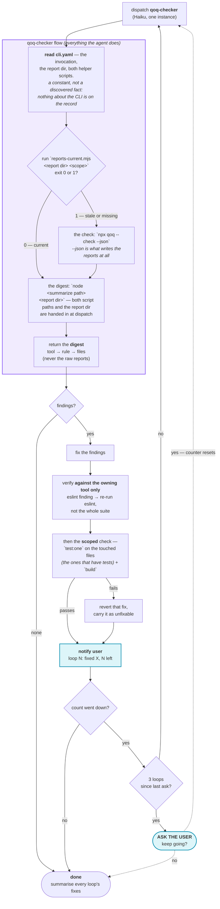
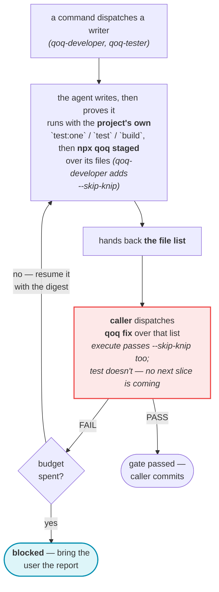

# `fix` — the check/fix loop

Tool findings only: Prettier, ESLint, Knip, JSCPD, Stylelint, and whatever else the project has enabled. Judgement calls are [`refactor`](./refactor.md)'s. This is the command every other one leans on, and the only one that invokes no other.

```text
/qoq fix                                  # qoq.config's srcPath
/qoq fix src/auth/token.ts src/auth/token.spec.ts
/qoq fix --skip-knip <files>              # mid-milestone only — see below
```

Given files, the verdict is about **those files and nothing else** — which matters because of who asks: [`execute`](./execute.md) needs to know whether _this ticket_ is clean and [`test`](./test.md) whether _this slice_ is, not whether the repo is.



## `--skip-knip` — the one tool with an opt-out

Scoping by reading the digest works for every tool but one. Knip answers a whole-repo question — is this export reachable — so a finding about a file _in_ scope is still computed from a repo where half the milestone doesn't exist yet. Mid-plan, an export ticket 4 will consume looks exactly like dead code to ticket 3, and the fix this command would apply is deleting it.

So [`execute`](./execute.md) passes `--skip-knip` on its per-ticket gate, and `qoq-checker` runs the `ticket` form instead of `full`:

```bash
rm -f <report dir>/knip-report.json && npx qoq --check --json --skip-knip
```

The `rm` isn't housekeeping: `summarize.mjs` reads every report off disk by name, so a leftover Knip report from an earlier full run would put a skipped tool's stale findings straight back into the digest — the skip would look like it worked while making the false positives worse. For the same reason reports are **never reused across the `ticket`/`full` boundary** in either direction.

The skip is **carried into the verdict line** — `PASS — 0 findings across 4 tools (knip skipped)` — because a caller reading a bare `PASS` will believe dead code was checked for. And only a caller who knows the code is mid-flight may ask for it: a bare `/qoq fix` never skips a tool on its own, since with no next ticket coming the finding is just true.

## The checker reports, the command fixes

`qoq-checker` is dispatched at the top of every loop and **never edits**: an agent permitted to both report and fix will do both, and the finding disappears into the diff instead of reaching you. Fixing stays here, un-delegated — a lint fix is a mechanical single-file edit that has to be attributed to the tool that reported it, and dispatching an agent per finding costs more than the fix.

Its whole job is three commands:

```bash
node <skill>/scripts/reports-current.mjs <report dir> <scope>   # 0 reuse, 1 re-run
npx qoq --check --json         # --json is what writes the reports
node <skill>/scripts/summarize.mjs <report dir>
```

All three lines come from `references/cli.yaml`, which is where the binary, its flags, the report directory and both helper scripts are stated **once**. None of it is on the discovery record: the CLI is a constant, so there's nothing to discover and no field to go stale.

- **Reports are reused only when demonstrably current.** `reports-current.mjs` is an mtime comparison — far cheaper than the tools, and what makes the loop head safe to call five times in a row. A stale digest read as current would make the command declare `PASS` over code nothing checked, which is why it's a script rather than a judgement call.
- **`--json` is not an optimisation** — it's what writes the reports at all. Reports land in the CLI's default output directory, next to the record and with the same lifetime, so `--output` is never passed.
- **The digest, never the raw reports.** An ESLint or JSCPD report on a real codebase runs to tens of thousands of near-identical lines. A raw report is opened only when one specific finding needs a line number, and only that slice is read.

## Verifying a fix

Two checks, answering different questions:

1. **The owning tool.** An ESLint finding is verified by re-running ESLint, a Prettier finding by Prettier — not the whole suite. The full re-check is the _next_ `qoq-checker` at the top of the loop, and that's what catches cross-tool damage: a Prettier rewrite reopening an ESLint rule, a deleted export turning up in Knip.
2. **The scoped check.** The owning tool says the finding is gone; it says nothing about whether the code still works. So each fix is followed by `test:one` on the touched files that have tests, plus `build` — unscoped, because there's no such thing as a scoped build and a fix that breaks the type graph shows up nowhere else.

A fix that fails the scoped check is reverted and carried as **unfixable**, and never retried. It stays in the digest, but the loop skips it from then on — otherwise every subsequent loop re-attempts the same fix, re-breaks the same test, and burns the budget on a known dead end.

## Why it loops

Fixes cascade: Prettier reformats a file and ESLint now has an opinion about it; a Knip-driven deletion makes another export unused. One pass is not enough, and pretending it is means handing back a "fixed" tree that fails the next check.

```text
loop 1  eslint 12 → 3, prettier 4 → 0     (13 fixed, 3 left)
loop 2  eslint 3 → 1, knip 0 → 2          (3 fixed, 3 left)
loop 3  eslint 1 → 0, knip 2 → 2          (1 fixed, 2 left)

3 loops, 2 findings left. Keep going?
```

Three loops is a **budget, not a limit** — a yes resets the counter rather than buying one more pass, because the useful question is "is this still going somewhere", not "have we hit ten". And **stuck beats looping**: a loop that closes with the finding count no lower than it opened with stops and reports instead of asking, since asking about a loop that provably isn't going anywhere is just a slower no.

## The verdict

One line, with the digest underneath:

```text
PASS — 0 findings across 4 tools
```

```text
PASS — 0 findings across 4 tools (knip skipped)
```

```text
FAIL — 2 findings left after 3 loops (1 unfixable: knip/unused-export src/api/legacy.ts)
```

That line exists for this command's callers — `refactor`'s green base, `execute`'s per-ticket gate, `test`'s per-slice gate. Same shape every time, so no caller has to parse a digest to learn whether it can carry on.

## The gate runs one thread up

A subagent composes nothing: it cannot dispatch another subagent. So `qoq-developer` and `qoq-tester` can neither run `fix` themselves nor reach around it into the CLI. They write, verify with the _project's own_ scripts, and hand back the list of files they touched; the command that dispatched them runs `fix` over exactly that list and resumes it on a `FAIL`, with the digest sent in.



Same gate, same scope, one thread up — and the retry budget moves with it, so an attempt is one dispatch-and-gate round rather than a loop inside the agent.
