# qoq

A [Claude Code](https://claude.com/claude-code) **Agent Skill** that applies the QoQ — _quality over quantity_ — standard to a JavaScript/TypeScript codebase: a few high-confidence, intention-revealing changes over a long list of nitpicks. It is **one skill with thirteen commands and twelve subagents**, all starting from a single cached project discovery. This page reflects the **`qoq-agent-skills` marketplace v7.2.0** (`.claude-plugin/marketplace.json`) — since v6.1.1 the marketplace version is kept in lockstep with the `@ladamczyk/qoq-*` packages.

| Command                     | What it does                                                                                                  |
| --------------------------- | ------------------------------------------------------------------------------------------------------------- |
| [`fix`](./fix.md)           | Check/fix loop over tool findings, ending on the `PASS`/`FAIL` verdict every other command calls.             |
| [`refactor`](./refactor.md) | Four sequential judgement passes over a scope, on top of a green base.                                        |
| [`bump`](./bump.md)         | Upgrades npm dependencies one attributable patch at a time.                                                   |
| [`plan`](./plan.md)         | Decomposes requirements into a milestone/ticket plan directory under `./plans/`.                              |
| [`replan`](./replan.md)     | Reshapes an existing plan against what's been learned — delivered work stays frozen.                          |
| [`execute`](./execute.md)   | Delivers an approved plan ticket by ticket, under TDD.                                                        |
| [`test`](./test.md)         | Writes Vitest/Jest coverage for code that already exists.                                                     |
| [`compress`](./compress.md) | Strips agent-facing markdown down to what an agent actually acts on.                                          |
| [`document`](./document.md) | _Experimental_ — writes down the why as JSDoc, agent-owned `./docs` and the README's `## Documentation` link. |
| [`mermaid`](./mermaid.md)   | Draws a Mermaid chart, validated to parse, printed or written into a doc.                                     |
| [`sheriff`](./sheriff.md)   | Sweeps a change for logic-level security problems; typed findings, remediated in `execute`.                   |
| [`review`](./review.md)     | Judges a delivery or a pull request against its intent; typed findings, proposed comments.                    |
| [`feedback`](./feedback.md) | Sends what you think of a command or agent to the qoq maintainers — a target, a category, optional text.      |

The earlier `review` and `gate` commands are gone: `fix` _is_ the gate, and reviewing a branch is `refactor` over the paths that changed. The separate `testing-gate`, `planning-gate` and `execution-gate` skills are folded in as `test`, `plan` and `execute`.

**The skill file routes and nothing else.** Each command's rules live in its own `references/*.md`, read only when that command runs, so a `fix` never pays for `execute`'s three hundred lines.

## Installation

### `skills` CLI

Vercel's [`skills`](https://github.com/vercel-labs/skills) CLI pulls the skill straight from the repo into your project's `.claude/skills/`:

```bash
npx skills add ladamczyk-it/qoq --skill qoq
```

Add `--global` to install it to your user directory instead, or `--agent claude-code` to target Claude Code explicitly.

### `agent-skills-cli`

[`agent-skills-cli`](https://github.com/Karanjot786/agent-skills-cli) is a universal installer that targets Claude Code and many other agents. Both CLIs expose a `skills` binary, so invoke this one through its `agent-skills` bin to avoid the name clash:

```bash
npx -p agent-skills-cli agent-skills add ladamczyk-it/qoq@qoq -a claude
```

Add `-g` to install globally to `~/.claude/skills/`.

### Claude Code plugin marketplace

The skill ships as the **`qoq`** plugin in the **`qoq-agent-skills`** [plugin marketplace](https://docs.claude.com/en/docs/claude-code/plugin-marketplaces):

```text
/plugin marketplace add ladamczyk-it/qoq
/plugin install qoq@qoq-agent-skills
```

Either way, the agents are installed by the skill itself rather than by the installer: the first run copies `agents/*.md` into the project's `.claude/agents/`, because an agent file sitting inside a skill directory is registered by nothing. It also deletes the copies of agents the skill has stopped shipping, so nothing stays dispatchable against a contract that no longer exists — and an agent you've edited yourself is reported as `kept (edited here)` and left alone.

## How you invoke it

**Scope is positional, in every command** — one spelling, so there's no flag to remember:

| Invocation                                     | Scope                                                  |
| ---------------------------------------------- | ------------------------------------------------------ |
| `/qoq fix`                                     | `qoq.config`'s `srcPath`                               |
| `/qoq fix src/auth/token.ts`                   | those files only                                       |
| `/qoq refactor src/modules/npm`                | those paths only                                       |
| `/qoq refactor --decisions auto <paths>`       | unattended: apply the mechanical tier, advise the rest |
| `/qoq bump`                                    | every outdated dependency                              |
| `/qoq bump --scan`                             | also vulnerable ones, via `qoq scan` — experimental    |
| `/qoq plan <requirements file or description>` | —                                                      |
| `/qoq plan <requirements> --tool jira`         | also raise the tickets there — experimental            |
| `/qoq plan <requirements> --diagrams`          | also chart the plan before approval — experimental     |
| `/qoq replan plans/<plan>/`                    | that plan only — refuses on uncommitted changes        |
| `/qoq execute [plans/<plan>/]`                 | omitted → asks, unless exactly one plan is approved    |
| `/qoq execute --source jira`                   | import a milestone from there, run it — experimental   |
| `/qoq execute <plan> --session-limit 60`       | stop before spending past 60% of the 5-hour limit      |
| `/qoq execute <plan> --docs`                   | also document each milestone — experimental            |
| `/qoq test <what to cover>`                    | —                                                      |
| `/qoq compress`                                | every `CLAUDE.md` and `AGENTS.md` git tracks           |
| `/qoq document`                                | files changed since the merge-base with the default    |
| `/qoq document src/auth`                       | those paths only                                       |
| `/qoq mermaid <description>`                   | print the chart                                        |
| `/qoq mermaid <description> --to docs/a.md`    | write it there — created, or appended                  |
| `/qoq mermaid <description> --to docs/a.md#x`  | at the end of the section whose anchor is `x`          |
| `/qoq sheriff`                                 | files changed since the merge-base, as they stand      |
| `/qoq sheriff src/auth 'src/**/*.ts'`          | a snapshot of those paths — intent not judged          |
| `/qoq sheriff main..HEAD`                      | that range's diff, no plan — intent not judged         |
| `/qoq sheriff <PR link>`                       | any repo's PR, security → proposed comments            |
| `/qoq review <PR link>`                        | any repo's PR vs its description → proposed comments   |
| `/qoq feedback`                                | asks which command or agent it's about                 |
| `/qoq feedback qoq-developer`                  | about that agent — any command, agent, or `qoq`        |

`mermaid`'s positional argument is a description, not a path.

### The nine flags

| Flag                    | Commands                    | What it does                                                                                       |
| ----------------------- | --------------------------- | -------------------------------------------------------------------------------------------------- |
| `--decisions auto`      | `refactor`                  | For callers that can't stop to ask: apply the mechanical tier, return everything else as advisory  |
| `--session-limit <pct>` | `execute`                   | Stop before spending past that share of the account's 5-hour limit                                 |
| `--weekly-limit <pct>`  | `execute`                   | The same for the 7-day limit; both default to `100`                                                |
| `--tool <tracker>`      | `plan`                      | `local` (default), `jira`, `linear`, `trello` — offer to raise the approved tickets there          |
| `--source <tracker>`    | `execute`                   | The same four values — import a milestone from there into a plan directory, then run it            |
| `--docs`                | `execute`                   | Experimental: run [`document`](./document.md) over each milestone after its gate                   |
| `--scan`                | `bump`                      | Experimental: also plan fixes for known vulnerabilities from `qoq scan`                            |
| `--diagrams`            | `plan`, `replan`, `execute` | Experimental: `qoq-artist` charts the plan before approval, and each milestone's docs in `execute` |
| `--to <path[#anchor]>`  | `mermaid`                   | Where the chart goes; without it the chart is printed                                              |

`--tool` and `--source` are the two ends of one road, and neither makes a tracker authoritative: `qoq execute` runs off `./plans/<plan>/` and nothing else, so the export is a projection for people who live in a tracker and the import is a one-time read.

### Experimental switches

`--docs`, `--scan`, `--diagrams` and the three trackers are experimental and off by default. Each has a config twin under [`future`](../../configuration.md#general) in `qoq.config.*`, which the skill finds with one grep over the file's source text — it never evaluates the config:

| Turns on                        | Flag                         | `future` switch                 |
| ------------------------------- | ---------------------------- | ------------------------------- |
| per-milestone docs in `execute` | `--docs`                     | `unstable_skill_docs`           |
| vulnerability fixes in `bump`   | `--scan`                     | `unstable_skill_bump_with_scan` |
| charts in `plan`/`replan`/docs  | `--diagrams`                 | `unstable_skill_diagrams`       |
| a tracker for plan and execute  | `--tool` / `--source` + both | `unstable_skill_plan_<tool>`    |

The trackers are the exception: the flag alone is refused. An untested write into a team's tracker is a per-project decision, not a per-run one, so without the matching switch the run stops in one line, before anything is asked or written. `--diagrams` in `execute` needs docs on as well, because the scribe's report is what the artist draws from. Standalone `/qoq document` and `/qoq mermaid` need no switch — typing them is the opt-in. `execute`'s security sweep and review are not switches at all: they run at every milestone, and the earlier `--review` flag and `future.unstable_skill_review` switch are gone.

Neither `--session-limit` nor `--weekly-limit` given means **no gate at all** — nothing is fetched, nothing printed. A plan run left alone finishes.

You don't have to name the command. "Is this ready to merge?", "fix the lint errors", "clean up the auth module", "remove dead dependencies", "bump the deps", "break this spec into tickets", "the plan's gone stale", "execute the plan", "write tests for this", "my `CLAUDE.md` is too long" all route to the right one. "Document why this works" and "draw this flow" reach `document` and `mermaid`; "is this change safe?" and "does this PR do what it says?" reach `sheriff` and `review`. `/qoq` on its own asks which command you meant rather than guessing between thirteen readings.

## Entry — one script, three checks

Every top-level run opens with a single script, and the branching lives in the script rather than in the skill file that gets loaded on every run. `SKILL.md` runs it through **dynamic context injection** (`` !`…` ``), so its output is already in the skill text when the thread first reads it — one tool round trip fewer on every run, and "once, at the head" stops being an instruction a thread can skip:

```bash
node "${CLAUDE_SKILL_DIR}/scripts/entry.mjs" --project "${CLAUDE_PROJECT_DIR}" --command "$0"
```

It prints a section per check — **agents**, **discovery record**, **usage stats** — each saying what to do about it. A missing or unknown command prints a single `command` section instead, still on exit `0` (any non-zero exit would abort the skill): the thread asks which command you meant, then runs the line it prints itself. Nothing else runs on that path, stats least of all.

A command invoked from inside another inherits all of it rather than re-checking: a `fix` dispatched from inside `refactor` is part of that refactor, not a second run — which is why an inner command opens its reference rather than re-invoking the skill.

A top-level run ends with one more step: if `scripts/learn.mjs --due` says it's time, the skill asks one question — did the command do what you needed? — whose answer goes to the qoq maintainers. See [`feedback`](./feedback.md).

```mermaid
flowchart TD
    Q["/qoq [command]"] --> ENTRY

    ENTRY["<b>scripts/entry.mjs</b><br/>--project &lt;root&gt; --command $0<br/><i>injected into SKILL.md at invocation —<br/>three sections of output</i>"]
    ENTRY --> CMD{"$0 a known<br/>command?"}
    CMD -->|"no — empty or unknown"| CASK(["<b>ASK THE USER</b><br/>which command? <i>never guess</i><br/>then run the entry.mjs line it printed"])

    subgraph CHECKS["what entry.mjs composes"]
        direction TB
        A["<b>1. agents</b> — sync agents/*.md into<br/>the project's .claude/agents/,<br/>delete the ones no longer shipped,<br/>keep the ones you edited"]
        A --> D["<b>2. discovery record</b> —<br/>hash the scripts block + the watched<br/>deps; current → nothing to do,<br/>stale → print hash + proposed + unresolved"]
        D --> S["<b>3. usage stats</b> —<br/>qoq.config `stats:`, then<br/>~/.claude/qoq/consent.md"]
    end

    CASK -.-> ENTRY
    CMD -->|"yes"| A
    S --> AGQ{"agents freshly<br/>installed?"}
    AGQ -->|"fix · test · execute"| AGASK(["<b>ASK THE USER</b><br/>they aren't registered yet —<br/>dispatch general-purpose,<br/>or re-run in a moment?"])
    AGQ -->|"everything else"| DQ
    AGASK -.-> DQ

    DQ{"record<br/>stale?"}
    DQ -->|"no — or command<br/>is compress"| SQ
    DQ -->|yes| FILL["<b>fill it in here, on this thread</b><br/>stamp the hash verbatim · check the<br/>proposed lines against the project's<br/>CLAUDE.md / AGENTS.md / README.md"]
    FILL --> AMB{"anything still<br/>ambiguous?"}
    AMB -->|yes| DASK(["<b>ASK THE USER</b><br/>the file stays unwritten until<br/>it's answered — half a record<br/>is worse than none"])
    DASK -.-> WRITE["<b>write the answer into the project's<br/>own docs</b> under a &lt;!-- qoq:discovery --&gt;<br/>block, <i>then</i> the record.<br/><i>survives the next npm install</i>"]
    AMB -->|no| WRITE
    WRITE --> SQ

    SQ{"consent<br/>recorded?"}
    SQ -->|"never asked"| SASK(["<b>ASK THE USER</b><br/>send anonymous usage stats?<br/><i>never defaulted</i>"])
    SASK -.->|"--consent yes/no"| SQ
    SQ -->|"yes or no"| RUN

    RUN["<b>run the command</b> — fix · refactor · bump ·<br/>plan · replan · execute · test · compress ·<br/>document · mermaid · sheriff · review · feedback"]
    RUN --> NOTE(["<b>end of run: notice to user</b><br/>what discovery repaired, one line<br/>each — <i>after</i> the real work"])

    classDef script fill:#8b5cf61f,stroke:#8b5cf6,stroke-width:2px
    classDef command fill:#f59e0b1a,stroke:#f59e0b,stroke-width:2px,stroke-dasharray:4 3
    classDef user fill:#06b6d422,stroke:#0891b2,stroke-width:2px

    class CHECKS script
    class RUN command
    class CASK,AGASK,DASK,SASK,NOTE user
```



## One record, six readers

Everything a command needs to know about the project is derived **once per top-level run** and cached as JSON:

```json
{
  "hash": "9f2c41ab77d0e315",
  "test": "npm test",
  "test:one": "npm run test -- {file}",
  "build": "npm run build",
  "runner": "vitest",
  "globals": true,
  "react": true,
  "conventions": "./testing-gate.md"
}
```

It lives at `node_modules/@ladamczyk/qoq-cli/bin/qoq-skill-discovery.json`, so it dies with the next `npm install` — the right lifetime, since every answer on it is only valid for the dependency tree currently installed.

| Command         | Fields it reads                                                 |
| --------------- | --------------------------------------------------------------- |
| `fix`           | `test:one`, `build`                                             |
| `refactor`      | the same                                                        |
| `bump`          | `test`, `build`                                                 |
| `plan`          | `test`, `build` — copied into the plan's Commands header        |
| `execute`       | `test`, `build` — for the milestone gate                        |
| `test`          | `test:one`, `test`, `runner`, `globals`, `react`, `conventions` |
| `qoq-developer` | all of it                                                       |

**The `hash` is what makes the check cheap**, and it deliberately covers less than the files it reads: only `package.json`'s `scripts` block — every command field quotes one verbatim — and the watched dependencies (`vitest`/`jest`, `@testing-library/react`) by name in the manifest and in whichever lockfile the project has. A version bump or an unrelated transitive dependency moves neither. `scripts/discovery-check.mjs` owns computing it, and the value it hands over is stamped verbatim rather than re-derived: two implementations that disagree mean a record that never matches and a re-derive on every single run.

**Three things are deliberately _not_ on it.** How the qoq CLI is invoked is a constant, spelled out once in `references/cli.yaml` — so there's no `run` or `check` field to go stale and nothing has to read the CLI's own docs to learn two flags. Which review lenses are installed isn't cached either, because that answer goes stale silently the moment somebody installs one; `ponytail-review` and `grilling` are resolved from the available-skills list at the moment they're needed. And there's no `lint` field: linting is what the CLI does.

**An answered question outlives the record.** When discovery has to ask you something, the answer is written into the project's own `CLAUDE.md` (else `AGENTS.md`, else `README.md`) inside a marked block, _before_ the record is written:

```md
<!-- qoq:discovery -->

- test (full suite): `npm test`
- test (one file): `npm run test:execute -- {file}`
- build: `npm run build`
- runner: vitest, globals on, React

<!-- /qoq:discovery -->
```

That block survives a reinstall, a deleted `node_modules`, and a fresh clone on another machine — so the second discovery is silent instead of asking the same question again.

[`compress`](./compress.md) is the one command that skips discovery entirely: it edits prose and runs no tool, so no line of the record bears on it. Its closing `fix` call does its own — deferred, not skipped.

## The agents

Twelve, in `agents/`. Everything is pinned except four: `qoq-developer`, whose tier is a property of the ticket and passed at dispatch, `qoq-scribe`, whose tier follows its mode and is passed at dispatch, and `qoq-architect` and `qoq-sheriff`, which inherit the session's model because a design error propagates into every ticket that inherits the contract and a missed security finding ships. Never pin a tier on those four. `qoq-reviewer` is pinned to Sonnet and always starts cold: what keeps it clear of the author's blind spots is that it holds none of the author's context, so it reads the diff as a stranger would.

| Agent               | Model      | Job                                                                    |
| ------------------- | ---------- | ---------------------------------------------------------------------- |
| `qoq-checker`       | Haiku      | run the tools, return the digest — one per `fix` loop                  |
| `qoq-bumper`        | Sonnet     | read a changelog, find what lands here — one per package               |
| `qoq-architect`     | _session_  | contracts · surface · risks · unknowns — one per plan                  |
| `qoq-developer`     | _dispatch_ | one ticket, red → green per criterion — one per ticket                 |
| `qoq-test-reviewer` | Sonnet     | do the specs test the criteria — one per ticket, pre-commit            |
| `qoq-tester`        | Sonnet     | write the specs for one slice — one per slice                          |
| `qoq-designer`      | Sonnet     | stack → smells → patterns — [`refactor`](./refactor.md)'s assessment 4 |
| `qoq-scribe`        | _dispatch_ | the why, as comments and docs — one per run or milestone               |
| `qoq-artist`        | Sonnet     | a validated Mermaid chart, or a reasoned decline                       |
| `qoq-sheriff`       | _session_  | logic-level security findings — one per sweep or recheck               |
| `qoq-reviewer`      | Sonnet     | spec · standards axes, in parallel — per milestone or plan             |
| `qoq-retro`         | Sonnet     | lessons from retries — per retried milestone, then the plan            |

Haiku for the lookup: every step is a file read or a name comparison, and the judgement calls are exactly the ones that agent is forbidden to make. Sonnet for the producers — past a lookup, short of the caller's model, and each has a green/red oracle attached to its output.

**Every dispatch passes the skill's absolute path.** An agent starts cold and can't derive it, and it's what `<skill>` stands for in every path an agent is told to run. On the one run where an agent isn't registered yet, `entry.mjs` prints the `general-purpose` fallback to dispatch instead — with the tier or the read-only prohibition restated by hand, since `general-purpose` otherwise inherits the session's model and every tool.

The agent frontmatter also sets how hard each one thinks and how long it may run: `qoq-checker` runs at `effort: low` (it runs tools and digests, nothing to deliberate), `qoq-architect` pins `effort: high` so a low-effort session can't thin the contract every ticket inherits, and `qoq-checker`, `qoq-bumper` and `qoq-designer` skip the project's `CLAUDE.md` (`omitClaudeMd`) because everything they act on arrives in the dispatch or the code. `qoq-developer` and `qoq-tester` are capped at `maxTurns: 200`; one that stops on the cap comes back marked partial, which is a hand-back that spends an attempt — never something to resume.

**Retries resume the agent.** When an agent goes back at the same tier with a digest, a verdict or an answer, the caller uses `SendMessage` to the agent that returned and sends only what's new — it still holds the files it read and its own last return, so a fresh retry would pay for them twice. A fresh dispatch with the full brief stays as the fallback when `SendMessage` is unavailable or the agent is gone, and is always used for escalations (a resumed agent keeps its model), a `plan` handoff you answered (a different ticket now), a `maxTurns` stop, the cold judges (`qoq-sheriff`, `qoq-reviewer`, `qoq-test-reviewer`) and `qoq-checker`. Wherever a `Log` records the retry, it says `resumed` or `fresh`.

**A tier that doesn't resolve is the user's to remap, never the agent's.** `opus`, `sonnet` and `haiku` resolve through Claude Code's `ANTHROPIC_DEFAULT_*_MODEL` settings, so a dispatch that comes back with a model error (not found, not enabled, unavailable) means that tier has no model on this host. The skill runs `scripts/model-tiers.mjs --failed <tier>` and does what it prints: tells you what the tier points at, stops the dispatch, and asks which model id it should map to and where — `local` (`.claude/settings.local.json`) or `user`. It writes that one key only once you've confirmed both. It never re-dispatches on another tier to get past the error, because a dearer fallback is silent spend, and never saves the choice to memory: the settings file is the one place you can see it and undo it.

## Standing rules

These hold in every command, and each command's reference assumes them rather than restating them:

- **Never assume a default.** Anything unclear is a question for the user, not a plausible guess with a note afterwards. Subagents can't ask, so an agent in doubt writes nothing and returns the question — a half-written artifact is indistinguishable from a stale one on the next run.
- **`npx` is for `qoq` and nothing else.** Every other command is the project's own script, verbatim. A composed `npx vitest …` skips the project's config, flags and setup files, and is plausible enough that nobody notices it was invented. A project with no script for something is a project that has to be asked. A `PreToolUse` hook in the skill's frontmatter enforces it — any other `npx` (and `npm exec` / `npm x`) is blocked for the rest of the session, inside agents too. The same hook refuses `node -e` and `node -p`: node runs a script file, never inline code.
- **Nothing that writes runs in parallel.** Not tickets, not test slices, not patches, not anything that edits or commits. Everything shares one working tree, and every check that matters is an attribution question — "did _this_ change break it?" — that a second concurrent writer makes unanswerable. Read-only agents may run together where a reference says so: `review`'s two axes.
- **An agent that reports never fixes.** `qoq-checker`, `qoq-bumper`, `qoq-designer`, `qoq-architect`, `qoq-test-reviewer`, `qoq-sheriff`, `qoq-reviewer` and `qoq-retro` return findings and edit nothing; an agent permitted to do both will do both, and the finding disappears into the diff instead of reaching you. Where an agent's tools are wider than its contract, `scripts/agent-guard.mjs` closes the gap as a `PreToolUse` hook in its frontmatter: a shell allowlist for `qoq-checker`, `qoq-bumper`, `qoq-sheriff` and `qoq-reviewer`, and test files only for `qoq-tester`. A hand-back that quotes the guard is a contract question for you, never a reason to re-dispatch as `general-purpose`.
- **Never buy green.** No `.skip`, no loosened assertion, no narrowed ticket, no weakened gate. A bar that can't be met is a report, not something to route around.
- **The CLI is a constant, and the verdict belongs to `fix`.** Nothing discovers the binary or derives its flags — `references/cli.yaml` states them once. What every other command gets by dispatching [`fix`](./fix.md) is the `PASS`/`FAIL` line, so scoping, report location and digest stay one answer instead of eight that drift.

## Who calls whom

Commands compose, but **only on the main thread** — a subagent cannot dispatch another subagent, which is why every gate runs one level up from the agent it gates.

| Command    | Calls                                                                                                | Called by                                                           |
| ---------- | ---------------------------------------------------------------------------------------------------- | ------------------------------------------------------------------- |
| `fix`      | its own `qoq-checker`                                                                                | `refactor`, `bump`, `execute`, `test`, `compress`                   |
| `refactor` | `fix`                                                                                                | `bump`, `execute`, `test`                                           |
| `bump`     | `fix`, `refactor` — both per patch                                                                   | —                                                                   |
| `plan`     | `grilling` + `domain-modeling` (external), `mermaid`                                                 | —                                                                   |
| `replan`   | `grilling` + `domain-modeling` (external), `mermaid`                                                 | —                                                                   |
| `execute`  | `tdd` (external), `fix`, `refactor`, `sheriff`, `review`, `document`, `mermaid`; its own `qoq-retro` | `plan` — offered at approval, never dispatched from inside it       |
| `test`     | `tdd` (external), `fix`, `refactor`                                                                  | —                                                                   |
| `compress` | `writing-for-agents` (external), `fix`                                                               | —                                                                   |
| `document` | its own `qoq-scribe`; offers `mermaid`                                                               | `execute` — per milestone, after the gate                           |
| `mermaid`  | its own `qoq-artist`                                                                                 | `plan`, `replan`, `execute` — when `--diagrams` is on               |
| `sheriff`  | its own `qoq-sheriff`; `fix` to re-gate                                                              | `execute` — every milestone, always                                 |
| `review`   | `code-review` (external), its own `qoq-reviewer` ×2 axes; `fix`; `sheriff`                           | `execute` — every milestone and once per plan, always               |
| `feedback` | —                                                                                                    | every top-level command, at the end, when `learn.mjs --due` says so |

Seven skills this one doesn't own are used, two ways. **On the main thread**, each is resolved from the available-skills list at the moment it's needed: `refactor`'s assessment 3 is `ponytail-review`; `plan` and `replan` open with `grilling`, with `domain-modeling` writing down the terms and decisions it settles; `compress` judges every cut against `writing-for-agents`; `review` frames its two axes on `code-review`. **Preloaded into an agent** by its `skills:` frontmatter, never invoked on the main thread: `tdd` under every spec `execute` and `test` write, and `codebase-design` under `qoq-architect`'s contracts. All seven normally arrive with qoq as plugin dependencies, and each reference states what to do when one is missing anyway — asking _before_ doing any work, while starting over is still free.

## Test and code conventions

`references/test-conventions.md` is the house rulebook — coverage philosophy, mocking, React Testing Library, MSW, and the lint rules that make a spec clean by construction. It sits on top of `tdd`'s base (what a good test is, seams, mocking, the red → green loop) and wins where the two conflict. Whoever writes a test reads both rather than reinventing a style.

`references/code-conventions.md` is its sibling for production code: names say what, comments say why, and a comment that predates the change is never removed without a recorded reason — it may be the only record of a decision. Both are read by whoever writes or tidies code. Where either conflicts with the project's own file — named on the record's `conventions` field — **the project's file wins**: it's human-written and knows things the skill can't infer.

## Usage statistics

The skill counts its own runs the way the CLI counts its own, and asks before the first one. The answer is resolved by `scripts/stats.mjs` rather than by the model — the project's `qoq.config.*` first (the same `stats:` key the CLI writes, so [one answer covers both](../../index.mdx#usage-statistics)), then `~/.claude/qoq/consent.md` for projects with no config. A decline is recorded and never re-asked. Each run posts the literal tool name `"qoq-skill"` and the command that ran, e.g. `["fix"]` — never your code, file names, paths, config contents, findings, or project names.
