# `plan` — requirements in, an approved plan directory out

Decompose a spec, PRD, or rough description into milestones and tickets that a cold subagent can pick up and [`execute`](./execute.md) can deliver. The plan directory is the whole handoff — it's what lets tomorrow's session resume work this one started, so its shape is fixed by a template — an `index.md` plus one `m<N>-<slug>.md` per milestone — rather than improvised: an orchestrator resuming a plan relies on "Status" and "Definition of done" meaning the same thing in every ticket it's ever handed.

**Three phases, in order.** Scope settles _what_, design settles _how_, breakdown settles _who does which piece_. Each one's output is the next one's input, and running them out of order is how a plan ends up with acceptance criteria nobody can trace to a requirement.

```mermaid
flowchart TD
    REQ["requirements — spec, PRD,<br/>or a rough description<br/><i>(read the file itself, never a paraphrase)</i>"]
    REQ --> SMALL{"one ticket's<br/>worth of work?"}
    SMALL -->|yes| PSTOP(["<b>stop</b> — no plan.<br/>straight to the code —<br/>the gate alone is the bar"])
    SMALL -->|no| GCHK{"<b>grilling</b><br/>installed?"}

    subgraph P1["Phase 1 — Scope"]
        direction TB
        GCHK -->|no| GASK(["<b>ASK THE USER</b><br/>install and re-run,<br/>or decompose as written?"])
        GASK -.-> GRILL
        GCHK -->|yes| GRILL["invoke <b>grilling</b> with the requirements<br/><b>+ everything already settled</b><br/><i>rounds of questions over the frontier,<br/>until nothing is silently assumed</i>"]
        GRILL --> SCEN["write the milestone <b>Scenarios</b> —<br/><b>Given</b> … <b>When</b> … <b>Then</b> prose,<br/>from what the grill settled.<br/><i>more than ~6 = milestone too big</i>"]
    end

    SCEN --> PEXP

    subgraph P2["Phase 2 — Design"]
        direction TB
        PEXP["dispatch <b>Explore</b> (read-only)<br/>which files look like the work ·<br/>surrounding patterns · local test conventions<br/><i>Explore locates, the architect audits</i>"]
        PEXP --> ASKIP{"single module,<br/>no new shape,<br/>no new dependency?<br/><i>every clause, or any doubt</i>"}
        ASKIP -->|"all hold"| ANONE["skip the architect —<br/><b>Contracts: none</b><br/><i>reported at approval</i>"]
        ASKIP -->|"otherwise"| ARCH["dispatch <b>qoq-architect</b><br/>(session model, once per plan)<br/>carries: requirements · <b>Scenarios</b> ·<br/>Explore's findings"]
        ARCH --> AOUT["returns <b>Contracts · Integration<br/>surface · Risks · Unknowns</b><br/><i>never edits, never guesses a contract</i>"]
        AOUT --> AUNK{"Unknowns?"}
        AUNK -->|yes| AASK(["<b>ASK THE USER</b> — here, before<br/>decomposing. an invented contract<br/>reads exactly like a real one"])
        AASK -.-> ARCH
    end

    AUNK -->|no| PDEC
    ANONE --> PDEC

    subgraph P3["Phase 3 — Breakdown"]
        direction TB
        PDEC["<b>decompose</b> — per ticket:<br/>size XS/S/M <i>(never bigger)</i><br/>complexity → agent tier<br/>Context that stands alone<br/><b>criteria as assertions, traced to a Scenario</b>"]
        PDEC --> PEST["<b>estimate.mjs</b> — tag the ticket,<br/>name the stack, ask what this<br/>project actually recorded last time"]
        PEST -->|"exit 1"| PESC["<b>escalate</b> — take the dearer tier,<br/>flag it for approval"]
        PEST -->|"exit 2"| PSPLIT2["<b>split</b> — tickets of this shape<br/>keep ending up blocked"]
        PSPLIT2 --> PDEC
        PESC --> PREV
        PEST -->|"exit 0"| PREV["<b>self-review</b> — the definition-of-ready gate:<br/>coverage · no placeholders · exact Files ·<br/>every criterion assertable · standalone Context"]
    end

    PREV --> PSAVE["save → ./plans/YYYY-MM-DD-[feature]/<br/>index.md + one file per milestone<br/><b>Plan status: draft</b>"]
    PSAVE --> PAPPR(["<b>ASK THE USER</b> — approve.<br/>surfaced: new deps · model ceiling ·<br/>every tier the estimator moved ·<br/>what was skipped"])
    PAPPR -.->|"changes"| PDEC
    PAPPR -.->|"approved"| PMARK["<b>Plan status: approved</b><br/>+ Commands header,<br/>copied from the record"]
    PMARK --> PEXPORT{"--tool<br/>local?"}
    PEXPORT -->|"jira / linear / trello"| PRAISE(["<b>ASK AGAIN</b> — raise the items now?<br/><i>an outward-facing write gets its<br/>own confirmation</i>"])
    PRAISE -.-> PHAND
    PEXPORT -->|local| PHAND["offer <b>qoq execute</b> —<br/>run it on a yes,<br/>dispatch nothing from here"]

    classDef user fill:#06b6d422,stroke:#0891b2,stroke-width:2px
    classDef skill fill:#ef44441f,stroke:#ef4444,stroke-width:2px
    classDef agent fill:#8b5cf61f,stroke:#8b5cf6,stroke-width:2px

    class PAPPR,GASK,AASK,PRAISE user
    class PHAND,GRILL skill
    class PEXP,ARCH agent
```



## When not to write a plan

- **One ticket's worth of work** doesn't get a plan. Go straight to the code; the gate alone is the bar. The dispatch machinery costs more than it saves below that size, and a one-ticket plan is ceremony that has to be maintained.
- **Two independent subsystems** don't get one plan either — that's two plans. A plan with two unrelated halves can never be milestone-ordered sensibly, and half of it blocks on the other half for no reason. That stop lives in Phase 3 rather than here, because the grill is usually what surfaces it: "these are two unrelated things" is a conclusion a round of questions reaches, not a property visible in the requirements as handed over.

If the requirements are a file, the file gets read. A paraphrase in the conversation has already lost the detail that turns into an acceptance criterion, and that loss is invisible until a ticket is being implemented.

## Phase 1 — the requirements get sharpened first

Requirements arrive vaguer than they look, and every gap left in them becomes a ticket whose acceptance criteria somebody invented. `grilling` closes those gaps while closing them is still cheap: rounds of questions over the whole frontier, you answering, until nothing is silently assumed.

It's checked **after** the one-ticket stop and **before** Phase 2 — the stop is one cheap read, and there's no point asking you to install an interview for work that turns out not to need a plan at all. Everything after it is the opposite: `Explore`, the architect, the decomposition and the estimator all read the requirements, so a gap still open when they start is a gap each of them reasons from.

- It invokes **`grilling`**, not `grill-me` — the latter is your front door to the same interview and can't be called from a skill, so looking for it would report it missing on a machine where it's installed.
- **It's handed what's already settled**, not just the requirements file. The grill's rounds open on the frontier, so a precise spec produces one short round rather than a re-ask of its own contents. Deciding for you that your spec has no gaps is what costs.
- **It leaves nothing behind but the conversation** — beyond what `domain-modeling` wrote (below), which is vocabulary and decisions, not the plan. So everything it settled has to land in the plan during decomposition, and **Requirements source** notes that the requirements were grilled.
- **`domain-modeling` runs alongside it.** It's resolved from the same available-skills list and invoked just before `grilling`, so its discipline runs during the interview: a term that conflicts with `GLOSSARY.md` is called out, a fuzzy one gets a canonical name, and each term and decision is written into `GLOSSARY.md` or an ADR under `docs/adr/` the moment it crystallises — the files every `qoq-developer` reads through `tdd`. Those files are **yours**, not the plan's: each one written or changed is listed in the approval summary and left in the working tree for you to review. Missing, or the grill skipped → no `domain-modeling` either, and it goes on the approval's skipped list rather than being asked about again.

Missing → it asks once, with install-and-re-run recommended and "decompose what's written" a real option that gets taken at your word and reported in the approval summary.

### Then the Scenarios

Phase 1's artifact is the milestone **`Scenarios`** field: the journeys this milestone has to make true, in your language, as `**Given** … **When** … **Then** …` prose. They're the settled requirements restated as observable journeys — not a fresh invention alongside them.

> A **criterion** is one ticket's assertion — _"a 6th request inside 60s returns 429"_. A **scenario** spans tickets — _"**Given** a signed-in user who has just hit the limit, **When** they retry after the window, **Then** the request succeeds and the counter has reset"_.

Nothing else in the plan holds the second, and a milestone's whole claim is that it's independently shippable — which is a statement about journeys rather than about assertions. They earn their place twice downstream: the architect consumes them, because a journey constrains a contract, and Phase 3 derives acceptance criteria from them. **More than about six per milestone means the milestone is too big.**

Prose, not Gherkin: the consumer is a model and needs no formal grammar, while real Gherkin invites somebody to point Cucumber at a plan.

## Phase 2 — `Explore` locates, the architect audits

`Explore` is one read-only subagent answering the questions no record can cache: which files look like the work, what patterns the surrounding code already uses, what the test conventions look like in the area being changed. That's high-volume reading with no business in the planning context. It's never asked for the build and test commands — those are already on the record, and asking twice is how two answers appear.

**`qoq-architect` runs once per plan**, after `Explore` and before any decomposition, and inherits the session's model because a design error propagates into every ticket that inherits the contract. Its dispatch carries the requirements, what the grill settled, the **`Scenarios`** verbatim — journeys are _what_ and contracts are _how_, and that's the order — and `Explore`'s findings. It designs with `codebase-design`'s vocabulary, preloaded by its `skills:` frontmatter; a return opening `codebase-design: not loaded` means the plugin is missing or off, and goes on the approval's skipped list. It returns four sections and edits nothing:

| Returns                 | Lands in                                                                                                 |
| ----------------------- | -------------------------------------------------------------------------------------------------------- |
| **Contracts**           | the **milestone's** `Contracts` field, passed verbatim into every dispatch and into the test-review gate |
| **Integration surface** | the relevant tickets' **Context** — the anti-scope-expansion payload                                     |
| **Risks**               | tickets' **Context**, and they feed **sizing** in Phase 3                                                |
| **Unknowns**            | questions asked **here, on this thread**, before decomposing                                             |

Under `--decisions auto` nobody answers the Unknowns. Each one goes into the approval summary and into the **Context** of the ticket it would change — never into a new section of the plan: `index.md` holds the template's sections and nothing else, because an open question parked in the index is one no dispatch ever carries, and it stays there after it's answered.

It exists because nothing else in the pipeline reads deeply enough at plan time to find what will break — and `execute` already files that failure by name: `scope-expansion`, _the developer found work nobody knew was there._

**It's skipped under one condition, and every clause has to hold**: the work lands inside a single existing module, invents no data shape, payload or persisted field, and adds no dependency. That's the plan whose design output would have been three short "none"s. A boundary crossed, a shape invented, a dependency proposed — **or any doubt about which of those is true** — dispatches it. A skipped architect is reported at approval, because it changes how hard you should read a `Contracts: none`.

## Phase 3 — acceptance criteria are assertions

This is the rule everything else in decomposition follows from. `execute` opens every ticket by transcribing its criteria into failing specs, one to one, before any implementation — so the criteria field is machine-facing.

> "Add rate limiting to the auth routes" is a **title**. "A 6th request inside 60s returns 429" is a **criterion**, because a spec can be written from it before a line of implementation exists.

Anything phrased as work-to-do rather than behaviour-to-observe leaves the red beat with nothing to transcribe, and the agent ends up inventing the assertion it was supposed to be handed. **A ticket that can't be asserted up front isn't decomposed yet** — a sharper test than the size table, and it catches a different failure: five files is an `M`, but "make the config loader more flexible" is unsizeable _because_ nobody can say what it would assert.

Criteria are **derived with the `Scenarios` in view**, so each one is traceable to the journey it serves — that gives it a parent rather than an author, and a criterion serving no scenario is either an invention or evidence the scenario list is incomplete. Where the milestone has a `Contracts` shape, criteria are written **against that shape**, so the developer asserts against the contract rather than against whatever its own implementation ends up returning.

### How to slice

These rules come from mattpocock-skills' `to-tickets`, which can't be invoked from here because its frontmatter sets `disable-model-invocation: true`.

- **Vertical, not horizontal.** A ticket cuts a narrow but complete path through every layer the feature touches (schema, logic, route, UI, the specs for each) and is verifiable on its own. "All the migrations, then all the routes, then all the UI" is three tickets that each pass their gates and deliver nothing until the last one lands — and a defect in how the layers meet shows up only at the end, when every ticket is already committed.
- **Prefactor first.** Make the change easy, then make the easy change. When the feature would be simpler if existing code were reshaped first (a function split, a type widened, a duplicate merged), that reshaping is its own ticket with no behaviour change: its criteria assert the existing behaviour still holds, and every feature ticket that relies on it `Depends on` it.

These change how the work is cut, never how a ticket is written: **Files** stay exact paths and criteria stay assertions. `to-tickets` leaves file paths out because they go stale in a tracker; a qoq ticket is executed straight away, and its **Files** is the scope a remediation is checked against.

### Sizing and complexity

**Size stops at `M`.** There is no `L` ticket: more than five files, or crossing a subsystem boundary, means the decomposition isn't finished. Milestones use `S`/`M`/`L`/`XL`, and an `XL` milestone should be its own plan.

**Complexity rates the model and nothing else.** `trivial` | `mechanical` | `moderate` | `judgment-heavy` picks the agent tier the ticket dispatches at. It does not decide which checks run — every ticket runs the identical steps. An inflated rating costs a bigger model and nothing more, which is the right way round for a rating that's easy to get wrong.

**Security sweep** is proposed, not rated: a ticket that touches authentication or authorization, parses input from outside the process, or handles a secret gets `Security sweep: ticket`, and the field is left off everywhere else — off means the milestone sweep only. It needs no switch, because the [sheriff](./sheriff.md) always runs in `execute`; you confirm or strike each proposal at approval.

**No test-only tickets for feature work.** A ticket that ships a feature carries its specs by construction — they're the red beat of its own TDD cycle. Splitting "build it" and "test it" into two tickets describes the same cycle twice and makes the second ticket's subagent write specs against an implementation whose reasoning it never saw. Test-only tickets stay legitimate for what they were always for: coverage over code that already shipped.

### Then the pick gets checked against what actually happened

Size and tier together are one decision — _this much work, delegated to that model_ — and the heuristics above are good defaults for making it. What they can't know is that on _this_ stack, this _kind_ of ticket has been handed to Haiku four times and needed a retry every time. [`execute`](./execute.md#report-the-outcome-back) records how each delegation actually went, so that record exists:

1. **Tag the ticket** — multiple tags, not one: `mechanical`, `architectural`, `pattern-repeat`, or a new one when none of those describe the work. The taxonomy is meant to grow.
2. **Name the stack** it lands in — `react`, `nestjs`, `cli`. A repo with two stacks estimates differently in each, and one averaged bucket hides both.
3. **Ask the script**, which reads `.claude/qoq-estimator.json` — committed, so the calibration travels with a clone rather than with whichever machine ran the plan:

```bash
node <skill>/scripts/estimate.mjs --tags architectural,mechanical \
  --stack react --size S --tier haiku
```

| Exit | Means                                                                                                           |
| ---- | --------------------------------------------------------------------------------------------------------------- |
| `0`  | the pick stands — in band, or too little data to argue with it                                                  |
| `1`  | **escalate.** Take the dearer `tier` it returns and flag the ticket so approval sees it                         |
| `2`  | **split.** Tickets of this shape keep going undelivered — rephrase or decompose rather than estimating it as-is |

A project that has never run `execute` has no store yet: the script exits `0` with `"verdict": "baseline"` and your own pick stands. That's the normal first run, not a failure.

**A miss is a ticket the tier didn't deliver inside its three-attempt budget.** Most of a bucket missing means the tier was too small, and a bigger model is much the cheaper side of that mistake — so **the adjustment only ever goes up**. There's no downgrade, because saving one rung isn't worth running an experiment on your ticket. Exit `2` is the odd one out: it isn't about the model at all, it fires when tickets of this shape keep ending up **blocked**, which is the same answer as a ticket that can't be asserted up front — it isn't decomposed yet.

What the script returns goes into the ticket's **Estimate** field as one line — tags, stack, verdict, miss count, and the tier change if there was one. Not the raw JSON. That field is what closes the loop: `execute` reports each outcome back against exactly those tags and that tier, so the next plan starts from a record this one improved.

**Read its `lessons` too.** They're what the [retro](./execute.md#the-retro) recorded against this exact bucket: a planning lesson, such as a Context that left the developer guessing or a ticket that should have been two, or a skill lesson, such as a gap in qoq's own briefing that this ticket's Context has to fill. Apply each one to the ticket before you write it; one that doesn't apply goes on the approval's list with a line saying why. The architect's dispatch carries the same planning and skill lessons for each stack the plan touches (`estimate.mjs --lessons --stack <stack>`) — an empty list is the normal first run.

### The self-review is a definition-of-ready gate

Before approval, the plan is read back as the cold subagent that will be handed one ticket of it and nothing else:

- **coverage** — every requirement and every scenario has a ticket behind it
- **no placeholders** — "similar to Ticket 1.3", "handle edge cases", "the auth module" are all unfinished work wearing the shape of finished work
- **exact `Files`** — paths, not descriptions. A subagent should never have to grep the repo to find out what "the relevant file" meant.
- **every criterion assertable** before the implementation exists, against the milestone's `Contracts` where there is one
- **standalone `Context`** — enough that the ticket needs no other ticket, and no part of this conversation, to be done

A ticket failing any of these isn't ready to dispatch, and finding that out here costs one edit rather than three attempts and an escalation.

## `--tool` — where the tickets end up

`--tool local` is the default and writes the plan directory and nothing else. `jira`, `linear` and `trello` add one beat after approval: raise the milestones and tickets in that tool. Any other value is a typo rather than a fourth tool — it asks rather than mapping to the nearest one.

**The plan directory is the source of truth in every mode.** `execute` runs off `./plans/<plan>/` and nothing else, so the export is a projection for the people who live in a tracker, never a replacement — `--tool jira` still writes the directory, still gets approved the same way, and an export that fails halfway leaves a plan that works.

**The three trackers are experimental; only `local` is tested.** Each is on only when the project's `qoq.config.*` sets its own switch — `future: { unstable_skill_plan_jira: true }`, `…_linear`, `…_trello` — found by one grep over the source text, never by evaluating the config. It's checked **before Phase 1**: switch off is a one-line stop naming the switch, with nothing grilled and nothing written, because finding out after approval would throw away the whole session. The flag alone never turns it on — an untested write into a team's tracker is a per-project decision, not a per-run one.

| Plan                    | Jira                       | Linear                    | Trello                         |
| ----------------------- | -------------------------- | ------------------------- | ------------------------------ |
| Milestone               | Epic                       | Milestone in that project | List                           |
| Ticket                  | Story under that epic      | Issue in that project     | Card in that list              |
| **Context** + **Files** | description                | description               | card description               |
| **Acceptance criteria** | description checklist      | description checklist     | a checklist named `Acceptance` |
| **Size** XS/S/M         | story points 1/2/3         | estimate 1/2/3            | label `size:S`                 |
| **Agent tier**          | label `qoq:sonnet`         | label `qoq:sonnet`        | label `qoq:sonnet`             |
| **Depends on**          | `is blocked by` issue link | `blocked by` relation     | named in the description       |
| **Status**              | label, not workflow state  | label, not workflow state | label, not list position       |

Two rows there are deliberate refusals. **Status is a label everywhere**, never the tracker's own workflow column: that column belongs to the team, and a state qoq sets on their behalf reads as live to every human looking at it. And **Trello has no relation type**, so `Depends on` goes in the description as plain text — attaching the blocking card looks tidier and carries no ordering, so a reader can't tell which way the dependency points.

Items are raised in dependency order — container, then milestones, then tickets, then the `Depends on` links once both ends exist — and each returned key or URL is written into that item's **External** field before the next one goes out. That's what makes the export idempotent: **a ticket with a non-empty `External` is skipped**, always, so a re-run after a crash doesn't duplicate forty issues into a shared project.

**Nothing here is a sync.** qoq moves a ticket through `todo → done` in minutes, so a tracker qoq wrote once and never revisited is confidently stale within the hour.

## Diagrams — when switched on

`--diagrams`, or `future.unstable_skill_diagrams: true` in `qoq.config`, adds one dispatch after the self-review and before approval: [`qoq-artist`](./mermaid.md#plan-and-replan--before-approval) charts the drafted plan into its `## Diagrams` section, so you approve the shape as well as the text. Off, nothing runs.

## A repo's share of a feature

A plan can be one repo's share of a **cross-repo feature**, coordinated by a chief-of-staff session from [`qoq-fullstack`](../qoq-fullstack.md) that started this one. When the launch prompt names a chief of staff, the requirements are the whole BRD, and the parked technology questions that land here become the first round of `grilling`. **Whether anything lands in this repo is decided first.** If nothing does, no plan is written and the run reports `no changes needed — <one line why>`, which is a valid outcome that unblocks the repos planned after this one. Every grilling round and the approval go to the chief of staff with `SendMessage`, never to a local prompt. On top of the usual plan:

- a **`Feature`** header line, and a **Serves** column in the Milestones table naming the master milestones each row serves;
- a contract consumed from `../contracts/<name>.md` goes **verbatim** into the consuming milestone's `Contracts`, and that milestone `Depends on` the provider, written `<repo>:M<N>`;
- a contract this repo provides is written to `../contracts/<name>.md` once the plan is approved, before the run reports back;
- **Depends on lists only hard dependencies.** Row order is the delivery order, and the chief of staff may ask for the rows to be reordered so another repo is unblocked sooner — the order changes, every number, dependency and file stays;
- a piece another repo needs (a contract, translations, a shared endpoint) goes in its own small milestone, so the consumer waits for that piece alone.

## Approval, then handoff

The plan is saved to `./plans/YYYY-MM-DD-<feature>/` — `index.md` with `Plan status: draft` and every milestone row `todo`, plus one `m<N>-<slug>.md` per milestone — then you're asked. Three things are surfaced because they're the ones worth vetoing: **new dependencies** any ticket needs — including any the architect _flagged_, since it never chooses one — the **model ceiling**, if a ticket is rated above the session's own model and no tier exists to escalate to, and every ticket whose **tier the estimator moved**, with what the bucket's record was. That last one is a judgement you're better placed to make than either the script or the model: you know whether this ticket really is the same shape as the four that went wrong, and it's your model spend.

Two more things get said here because they're the ones you **can't see from the plan**: whether the `grilling` round was skipped (and so `domain-modeling`), and whether the architect was (or reported `codebase-design` not loaded). None is a veto item, but they change how hard you should read the acceptance criteria and a `Contracts: none` respectively. With diagrams on, what the artist drew and declined is listed too, one line each.

On approval the status flips to `approved` and the **Commands** header is filled from the record, so the milestone gate still has the project's full build and test commands in a session days later with no memory of this one. Then the two handoffs, in this order — **export first**, because it's the one that leaves the machine and you should see it land before anything starts changing code, and then [`execute`](./execute.md) is **offered** and run on a yes — except for a repo planning its share of a feature, which offers nothing and reports to the chief of staff, who starts execution. Never dispatched from inside `plan`: folding execution in would put decomposition reasoning back into the context that has to run the plan.
