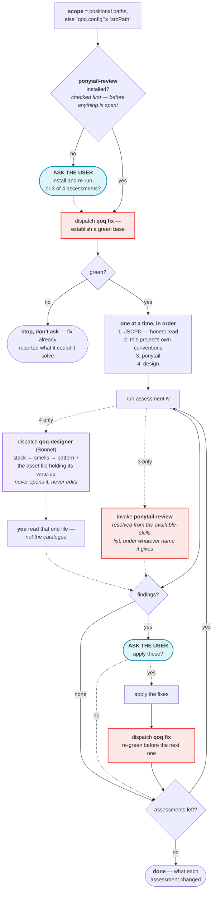

# `refactor` — green base, then four assessments

[`fix`](./fix.md) is the tool findings. This is the judgement calls, and it runs **after** the tools are quiet, one assessment at a time.

```text
/qoq refactor                                   # everything under qoq.config's srcPath
/qoq refactor src/modules/npm src/helpers       # those paths only
```

The default comes from `qoq.config.js`'s `srcPath` — the project already declared what its source is, and every other qoq tool respects it. Given paths, it runs on **those only**: four assessments over a large repo is a lot of reading, most refactoring intent is local, and it's what makes [`bump`](./bump.md)'s per-patch call practical.



## The one external lens — checked before anything runs

Assessment 3 is `ponytail-review`, the only assessment the skill doesn't own. It's resolved from the available-skills list under whatever name that list gives it — a bare `ponytail-review` and a `ponytail:ponytail-review` don't resolve interchangeably, so the prefix is neither added nor stripped to make it look tidier.

**The check happens before the green base is even dispatched.** Missing means a quarter of the run is about to be silently downgraded, and one of the two answers is "install it and start over" — so it asks while a re-run is still free, rather than after a green base and two assessments:

> `ponytail-review` isn't installed, so assessment 3 (what can we delete?) can't run. Assessments 1, 2 and 4 are unaffected.
>
> - **Install and re-run** _(recommended)_ — then `/qoq refactor <scope>` again.
> - **Proceed without it** — you get 3 of 4 assessments. Nothing else asks what to delete: assessment 4 proposes structure, and runs unopposed without this.

That last clause is the point worth saying out loud. The four assessments are deliberately in tension — 3 argues for less code and 4 argues for shape — so dropping 3 doesn't just remove a pass, it removes the counterweight to the one that follows it. **Recommended is not a veto**: proceed-without is a real option, the remaining assessments run in full, and the skipped one is reported in the final summary rather than only in a message you scrolled past. Under `--decisions auto` there's nobody to ask — the assessment is skipped and the gap comes back as an advisory with the others.

## Green base first

It opens by dispatching `fix` over the same scope and refuses to start until that comes back clean. Refactoring on top of live findings is guesswork — you can't tell what your change did from what was already broken, and the next `fix` rewrites your work anyway.

**Not green → it stops, and doesn't ask.** `fix` has already asked its own "keep going?" and already reported what it couldn't solve; a second question about the same wall is noise. The base is scoped to the same paths, so a `refactor src/modules/npm` never stops on a finding in a file it will never touch.

## The four assessments

| #   | Assessment                         | Reads                                    |
| --- | ---------------------------------- | ---------------------------------------- |
| 1   | **JSCPD, honestly**                | the duplication report                   |
| 2   | **this project's own conventions** | how the surrounding code already does it |
| 3   | **ponytail**                       | the `ponytail-review` lens               |
| 4   | **design**                         | `qoq-designer` — smells, then patterns   |

**Sequentially, never in parallel.** They overlap by design — duplication is often a missing pattern, and ponytail's answer to a pattern is often "delete it". Run together they write conflicting patches into the same files. The order is cheapest-and-most-mechanical first, so the judgement-heavy passes read a smaller, already-deduplicated tree.

**"Honest" JSCPD** is the whole point of the word: the report lies in both directions — it hides real duplication under the configured threshold and flags coincidental similarity that means nothing. Honest means judging each block and saying out loud "this one isn't worth touching", not editing code until the number goes down.

**Assessment 2 is consistency, not catalogue.** It asks whether the code does things the way the rest of _this_ codebase already does them: naming, module shape, where errors are handled, how config is threaded through. Assessment 4 asks the different question of whether it's the right pattern at all — code can be consistently wrong, or textbook and unlike everything around it.

**Every assessment's findings pass through the skill's code conventions before they're applied** — ponytail's included, whose whole job is deletion. Names are part of assessment 2's consistency question, and a name that needs a comment is a name to change. A finding that removes or rewrites a pre-existing comment needs a reason those conventions accept, or the comment stays; each removal is reported verbatim with its reason, and goes into the commit body if the run is committed.

A missing lens is a reported gap, never improvised around with a substitute pass.

## Assessment 4 — `qoq-designer`, and the file it hands back

`qoq-designer` is dispatched over the same scope. It works out which stack the scope is **actually** written in — from the scope's files, not from `package.json`, because a scope of server modules in a React project is not a React scope — reads `assets/patterns/index.md` (the smell→pattern routing table) plus the per-stack table that scope needs, hunts smells in the code, and returns each smell with the pattern that resolves it and **the asset file holding that pattern's write-up**. It never opens that file, and it never edits.

Then the main thread reads the file it named, and only that one. The split is the whole design:

- The write-ups are long and stack-specific, and there are twenty-one of them across the base catalogue and React's. Loading the catalogue to discover that nothing in the scope needs a pattern is exactly the cost this avoids.
- Pattern documentation argues for its pattern. An agent that reads Observer's write-up before scanning finds Observer. **Smell first, catalogue second** is the order that finds real problems instead of confirming ones you went looking for.
- The refactoring itself needs the depth — the stack-idiomatic shape, the worked before/after, the "when it's the wrong call" section — and it needs it in the thread that talks to you and applies the change.

Every write-up leads with **the cheaper thing the language or framework already offers**: a function parameter, a discriminated union, a `Record` of handlers, a module — or, for most of the React rows, passing `children` instead of the data a subtree needs. A pattern that buys nothing over a union type is ceremony proposed to a codebase that just finished assessment 3, and you'd be right to decline it.

A general-purpose design-pattern reviewer is never substituted for it: those teach the Java-shaped GoF forms, and a TypeScript codebase reaching for `AbstractFactory` where a discriminated union does the job is worse than no assessment at all.

## Approve, apply, re-green

1. **No findings → next assessment.** Nothing to say, nothing to ask.
2. **Findings → ask, always.** `fix` applies tool findings without asking because a lint rule isn't a matter of taste. These are: every one changes shape, not correctness. Approval is **per assessment**, never once up front for all four — the user who wants deduplication hasn't thereby asked for a pattern swap.
3. **Declined → next assessment, unchanged.** A no is an answer, not a retry.
4. **Approved → apply, then dispatch `fix` again.** Reshaping code produces new formatting and lint findings, and the next assessment deserves the same green base the first one got.

Everything is reported at the end, per assessment — including the ones that found nothing and the ones you declined.

## `--decisions auto`

**`auto` changes who decides, never what runs.** The green base and all four assessments run exactly as above, in order, with `qoq-designer` dispatched for assessment 4. That most of their findings come back as advisories is no reason to skip one: an assessment never run returns no advisories, and that reads the same as a clean one. Reading the scope yourself in place of an assessment is the improvised substitute pass the rule above forbids, and each of the four is reported separately — its findings, `none`, or `skipped — <why>` — because that is what a caller writes down.

Two callers can't stop to answer four questions: [`execute`](./execute.md)'s milestone gate, which runs with nobody watching, and [`bump`](./bump.md), which would otherwise ask per patch on top of its own sign-off. So the interactive behaviour above stays the default, and there's one flag:

|                                                                     | interactive _(default)_   | `--decisions auto`                            |
| ------------------------------------------------------------------- | ------------------------- | --------------------------------------------- |
| **mechanical** finding — formatting-shaped, one obvious rewrite     | asked about with the rest | **applied**                                   |
| **judgement** finding — a different shape, a pattern swap, deletion | asked about               | **returned as an advisory, nothing changed**  |
| removing or rewriting a comment that predates the run               | asked about               | **returned as an advisory, nothing changed**  |
| what the caller gets                                                | what it applied           | what it applied, plus every advisory verbatim |

The split is the same line `fix` and `refactor` already draw between them: a finding with exactly one sensible resolution isn't a matter of taste; a finding that changes shape is. `auto` doesn't lower the bar, it declines to guess — and advisories belong to whoever asked, so the milestone gate records them in the milestone summary and `bump` carries them into its per-package report.
