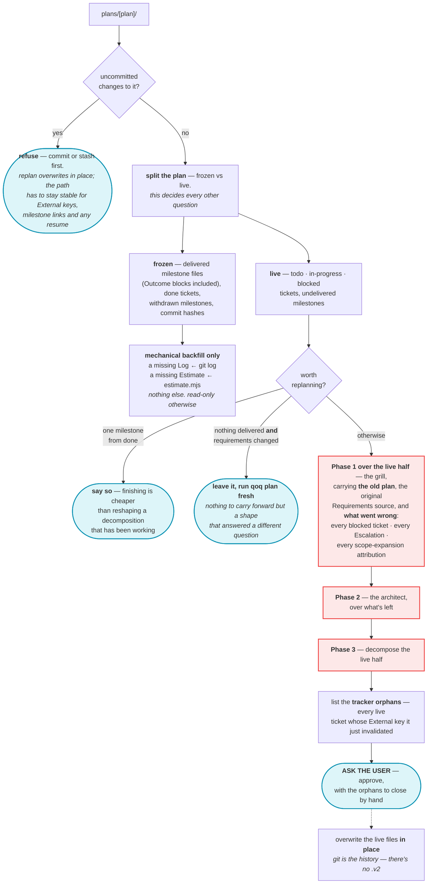

# `replan` — an existing plan, reshaped against what's been learned

```text
/qoq replan plans/2026-08-14-rate-limiting/
```

A decomposition written before anyone had tried it can be brought forward. `replan` re-runs [`plan`](./plan.md)'s three phases over a plan directory that already exists — it is those phases, not a second copy of them, so everything `plan` does still applies. What follows is only what's different.



## Frozen and live

The plan is split before anything else, and this split is what makes replanning a half-executed plan safe. A bare `plans/<name>.md` is the single-file layout from before v7.0.0 and isn't replanned: `replan` says so and offers [`plan`](./plan.md) over what's left of it.

**Frozen** — every delivered milestone's file, Outcome block included, `done` tickets wherever they sit, withdrawn milestones, and every commit hash. **Read-only input.** A `done` ticket that gets re-decomposed loses the link between its criteria and the commit that satisfied them, and at that point the history stops meaning anything. A delivered milestone file's own rule is that nothing in it is ever re-planned or re-gated.

Frozen parts get a **mechanical backfill only**, and only where a field the current template carries is simply absent — a missing `Log` reconstructed from `git log`, a missing `Estimate` from `estimate.mjs` against the tags and tier the ticket already records. Nothing else: a backfill that changes a criterion, a `Files` list or a status is a rewrite wearing a migration's clothes.

**Live** — `todo`, `in-progress` and `blocked` tickets, and undelivered milestones. This is the only thing `replan` may rewrite, and it gets the full reshape.

**Numbers are append-only.** A reshape rewrites live milestone files in place, and their index rows with them. A new milestone takes the next unused `m<N>`, and no existing one is renumbered — ticket ids, `External` keys and every `Log` line cite those numbers. A live milestone the reshape drops keeps its file, unchanged, and its index row becomes `withdrawn — <why>`, so a link to it never dangles.

## When not to replan

Two stops, both cheaper than the reshape:

- **One milestone from done** → it says so. Finishing is cheaper than reshaping, and a reshape at that point throws away a decomposition that has been working.
- **Nothing delivered _and_ the requirements changed substantially** → that isn't a replan. Leave the directory as it is and run [`plan`](./plan.md) fresh; there's nothing to carry forward but a shape that was answering a different question.

## The grill's best input is what already went wrong

Phase 1 runs over the live half, and its dispatch carries three things beyond the usual: **the old plan**, so the frontier opens on the gaps rather than on what's settled; the original **`Requirements source`**, if it still resolves; and **what went wrong** — every `blocked` ticket, every **Escalation**, and every `scope-expansion` attribution.

That last one is the point. Those are direct evidence that the old decomposition was wrong — a ticket nothing could deliver, a tier that had to move, work nobody knew was there — and they're already sitting in the milestone files.

It's also why re-grilling costs almost nothing. The grill is handed everything settled so its frontier opens on the gaps, and here "settled" is enormous: the whole old plan, plus milestones that demonstrably work. A precise spec ends in one round. The grill is self-limiting, which is why `replan` has no skip mode.

## Refuse on uncommitted changes

If any file in the plan directory has uncommitted changes, `replan` **refuses and says why**: commit or stash first. Not a warning — a stop.

It overwrites the live files **in place**, because the paths have to stay stable: `External` keys, links between milestone files and any resume all reference the plan by name. Git is the history, so there's no `.v2` file. But overwriting uncommitted work destroys the only copy of it, and the guard costs one `git status`.

## Tracker orphans are reported, never synced

Any **live** ticket carrying an `External` key loses it when it's re-decomposed, and the Jira issue or Trello card it was is now dangling. They're listed at the approval beat so you can close them by hand.

**`replan` does not sync.** The export writes once and never syncs back — that's the skill's position in both directions, and syncing is the entire problem it deliberately refuses to own. Reporting the orphans is the whole of the obligation.

## Diagrams, when switched on

The same pre-approval [`qoq-artist`](./mermaid.md#plan-and-replan--before-approval) dispatch as [`plan`](./plan.md#diagrams--when-switched-on), under the same switch. It redraws charts of the live part only; charts of frozen milestones stay as they were approved.

## Calibration is untouched

`.claude/qoq-estimator.json` is left alone. A recorded outcome means "this shape of work at this tier went this way", which stays true however the plan is now shaped.
