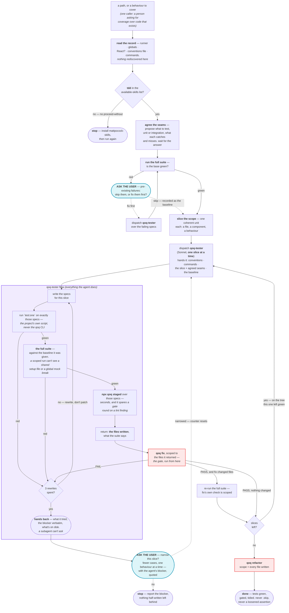

# `test` — coverage for code that already exists

Unit and integration tests on Vitest or Jest. The record's `runner` field already says which of the two this project is, and a project with neither never got past discovery — so there's no detection phase here.

**One caller: a person asking for coverage over code that already exists.** That's what keeps this command to a single success condition — green, gated, tidy. A ticket's own assertions are not its work: [`execute`](./execute.md)'s `qoq-developer` raises them to the conventions itself, in the thread that wrote the implementation — it can't dispatch a subagent anyway, and a ticket arrives pre-sliced, which is the one thing this command's slicing exists to do.

Browser-driving suites are a different discipline whose conventions don't transfer; if one ever needs a command, it's a different command.

## `tdd` first

Every spec this command writes sits on `tdd`. Before the seams are proposed: is it in the session's available-skills list, under any name? Not there → the run **stops**, even if its files are on disk: a disabled plugin stays in the cache, and the list is the only thing that knows it's off. `qoq-tester` lists `tdd` in its `skills:` frontmatter, so Claude Code preloads it — but an unresolved entry starts the agent without it, silently, so the check can't be skipped. A tester dispatched as `general-purpose` is told to invoke `tdd` with the Skill tool first.

**`tdd` isn't invoked on this thread**: loaded here, its red → green loop would pull the orchestrator into writing the specs itself, and the tester, the gate and the refactor would never run. The stop has no proceed-without — `tdd` normally arrives with qoq as a plugin dependency; install it with `/plugin install mattpocock-skills`, then run `test` again.

## Seams are agreed before anything is written

`tdd` writes no test at an unconfirmed seam. The public interfaces the scope exposes are worked out, and the **seams to test** are proposed — one line each on what it catches and what it misses, and whether it's a unit seam (one piece in isolation) or an integration seam (a flow across pieces) — then you answer. It's the one question asked before the baseline run, and it decides where the testing effort lands.

## The baseline run

The full suite runs **before anything is written**. A run afterwards can only tell you "something is red", not "_your_ file made it red" — and without that, a project with three pre-existing failures either blocks a command that did nothing wrong, or learns to shrug at real breakage.

A red base is a question, not a stop, and the two answers are genuinely different jobs:

- **Skip** records the failing specs as the baseline. They're excluded from the post-write judgement and reported at the end, untouched.
- **Fix first** is work this command is qualified to do — they're test files, its own material. They're rewritten under the same three-rewrite budget, then the base is re-checked.

What it never does is quietly absorb them into the new work's result. (Unlike [`refactor`](./refactor.md), which stops dead on a red base — the failing thing there isn't its own material.)

## Slices, one at a time

The scope is cut into coherent units — a file, a component, a behaviour — and `qoq-tester` is dispatched once per slice, sequentially. Each slice ends with a full suite run whose whole purpose is attribution; if two agents are writing while it runs, a red result names neither of them. Sequential also means each slice starts from the tree the previous one left green.

N slices is N full-suite runs — that cost is the design, not an oversight. Every dispatch carries the record's path, the paths to the skill's test and code conventions, the slice stated as narrowly as it can be stated, the baseline of already-red specs, and any specs already in place for this slice — a ticket's own hand-written assertions get rewritten to standard, not duplicated by a second file asserting the same thing.

`qoq-tester` writes tests and **only** tests: a spec that fails because the code under test is broken is a finding it reports, never a licence to edit production source.

## Two checks per slice, one refactor at the end

1. **The tester's own proof, before it hands back.** `test:one` on the specs it wrote — they have to run and pass — then the full suite against the baseline it was given, because a scoped run can't tell you a new spec broke someone else's through a shared setup file or a global mock. Then `npx qoq staged` over those specs, which costs seconds and spares a gate round on a lint finding.
2. **[`fix`](./fix.md) from here, scoped to exactly those spec files.** This is the gate. It runs **last** rather than first, which inverts the obvious order for a reason: `fix` rewrites files — Prettier reformats, ESLint autofixes — so it has to be the thing that verifies its own rewrites, and it does, by re-running `test:one` on every file it touches and reverting any fix that goes red. A check placed before it would be validating a version about to change. If `fix` changed anything, the full suite is re-run before the next slice.

**`refactor` runs once, after the last slice**, scoped to every file written. Green and gated is not the same as good, and test files are where near-duplicate arrange blocks and copy-pasted setup pile up fastest — nothing in `fix` has an opinion about that. Once rather than per slice, because duplication _between_ specs is most of what there is to find, and that isn't visible until they all exist.

## A red result rewrites, it doesn't patch

When a slice comes back red the spec is **rewritten against what the run actually reported**, not amended in place. A spec patched to get past one assertion accumulates scaffolding that has nothing to do with the behaviour under test, and each amendment is judged against a file the previous amendment already reshaped. A gate `FAIL` lands in the same place for the same reason.

**Three rewrites, then the agent hands back and you're asked.** Running out isn't a report-and-stop; it's a question — three attempts at one slice that all end red usually means the slice was too wide to write in one go, and the smallest useful thing to ask for is fewer cases or one behaviour at a time. The agent returns `status: handoff` and you're asked with its `blocker` quoted verbatim. A narrowed slice resets the counter; a no ends the run with the blocker reported and the handoff's `files` removed — nothing half-written left behind.

## Conventions

`tdd` is the base — what a good test is, seams, mocking, the anti-patterns. The skill's own `test-conventions.md` is the house rulebook on top of it, and wins where the two conflict — React Testing Library and MSW conventions, and the lint rules that make a spec clean by construction (no `.only`/`.skip`, unique titles, at least one assertion per test, no conditionally-registered tests). It's readable on its own, so whoever writes a test in the project should read it rather than reinvent a style.

The project's own conventions file, named on the record's `conventions` field, **wins over both** — it's human-written and knows things the skill can't infer.
